

  

<h1 align="center">A4N</h1>

<strong>From novel writing to comics, video and interactive stories</strong>

<a href="README.md">中文</a> · English

  <a href="docs/public/getting-started.en.md">Get started</a> ·
  <a href="docs/public/assets/demo.mp4">Watch / download demo</a> ·
  <a href="#the-workflow-in-screenshots">Screenshots</a> ·
  <a href="#a4n-at-a-glance">Features</a> ·
  <a href="#creative-workflows">Workflows</a> ·
  <a href="#core-design">Core design</a> ·
  <a href="https://github.com/GTJasonMK/A4N/issues">Report an issue</a>

A4N brings novel writing, story knowledge and multimedia adaptation into one creative system. Start from an idea or import an existing work, develop its blueprint, outlines, chapters and profiles, then make comics, videos or interactive stories.

> A4N is still in development and currently runs from source. There is no official installer. Setup requires a development environment, PostgreSQL and your own model or API configuration.

## A4N at a glance

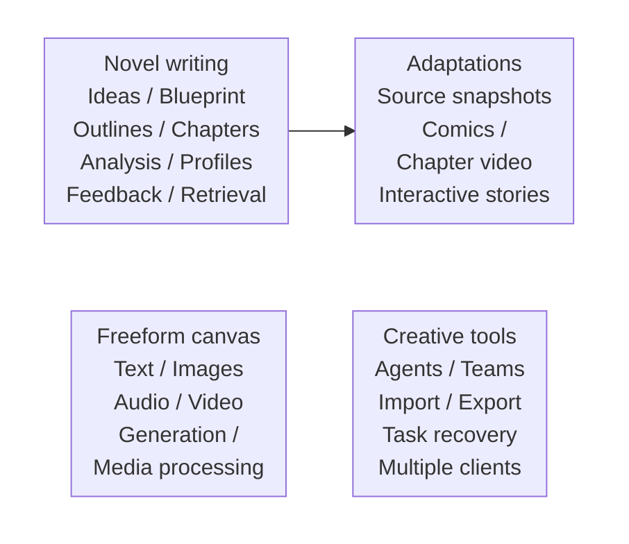

This is a capability map: novels and their adaptations share source references; the canvas also works independently. The sections below explain each workflow.

| What you want to understand | Start here |
| --- | --- |
| Write a novel and keep earlier material organized | [Novel writing](#novel-writing) · [Analysis and fact feedback](#analysis-and-fact-feedback) |
| Prepare images, portraits and production assets | [Images and portraits](#images-and-portraits) |
| Adapt a story into another medium | [Comics](#comics) · [Chapter video](#chapter-video) · [Interactive stories](#interactive-stories) |
| Connect generation and media-processing steps | [Freeform canvas](#freeform-canvas) · [Agents and automation](#agents-and-automation) |
| Manage source changes, collaborators and delivery | [Source synchronization](#source-synchronization) · [Collaboration and import / export](#collaboration-and-import--export) |
| Understand the system and task recovery | [Core design](#core-design) · [Get started](#get-started) |

## The workflow in screenshots

Follow one fictional project, **The Reversing Clock (逆行时钟)**: write a novel, organize its story knowledge, then choose comics, chapter video or interactive storytelling as separate adaptations. The freeform canvas has its own entry point. Key pages appear beside their workflows below; the [complete 14-screenshot tour](docs/public/workflow-tour.md) follows the process in order. Click any screenshot to view its original size. The captured interface is in Chinese, with English explanations in the tour.

*Project management: the novel and its adaptations each open their own workspace; the independent canvas supports custom workflows.*

Screenshots use the real application with isolated fictional data, deterministic local test-provider responses and prepared illustrative media. See the [media and validation notes](docs/public/demo.md#新增页面截图--workflow-screenshots) for the scope.

View the earlier 50-second Between Mountains and Sea walkthrough

*The example project Between Mountains and Sea (山海之间). Click the screenshot for a 50-second walkthrough. The demo uses a fictional story, prepared assets and simulated model responses; see the [media notes](docs/public/demo.md).*

## Creative workflows

Follow the arrows, with workflows arranged horizontally where practical. Read steps inside a box from top to bottom; in-box arrows preserve step order. Solid arrows show process or data flow; dashed arrows show optional paths. Edit manually, generate individual steps or inspect saved results without running an entire chain at once.

### Novel writing

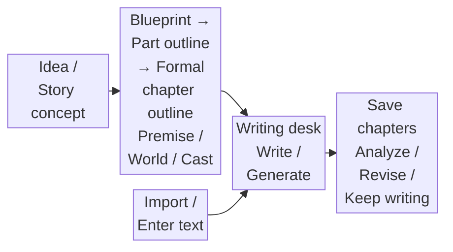

*The writing desk keeps the blueprint, character context, outline and chapter text together. The [complete tour](docs/public/workflow-tour.md) also shows idea development, the blueprint and formal chapter outlines.*

Blueprints, outlines, chapters and profiles can be inspected and edited. Local revisions have a separate review flow:

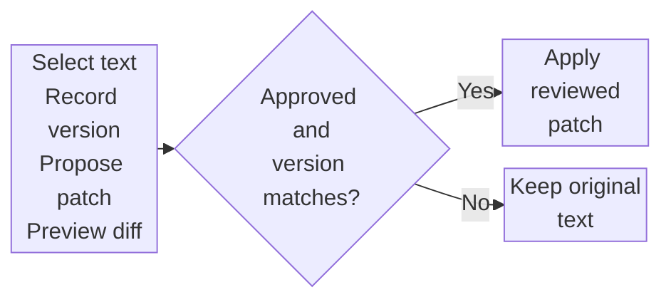

### Analysis and fact feedback

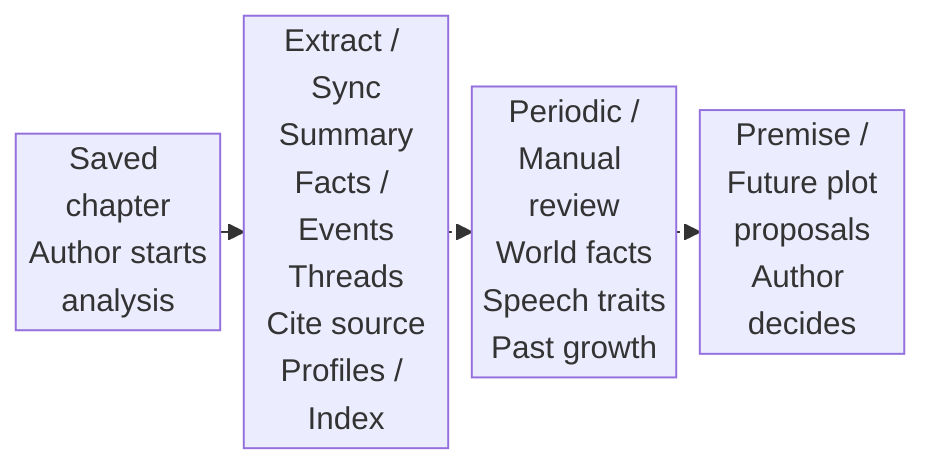

Analysis updates characters, objects, scenes and story threads; later writing uses this material for the current task:

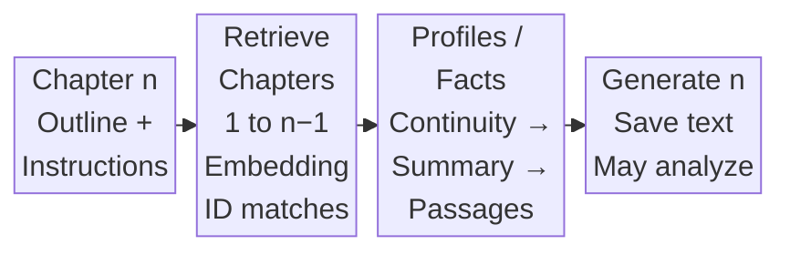

Less frequent updates consolidate after 5 distinct chapters by default; the interval is configurable, and important world-rule changes can trigger earlier consolidation. Formal outlines are preserved; missing outlines receive retrospective ones. Editing old chapters retracts invalid sources while preserving later manual changes. Saving alone makes no model call. See [Fact feedback](docs/public/fact-feedback.zh.md) (Chinese) and the [feedback example](docs/public/assets/self-feedback.en.svg). This manages writing context; it does not retrain the model.

*Review analysis and synchronization status beside the chapter, including summaries, events, story threads and character changes.*

### Images and portraits

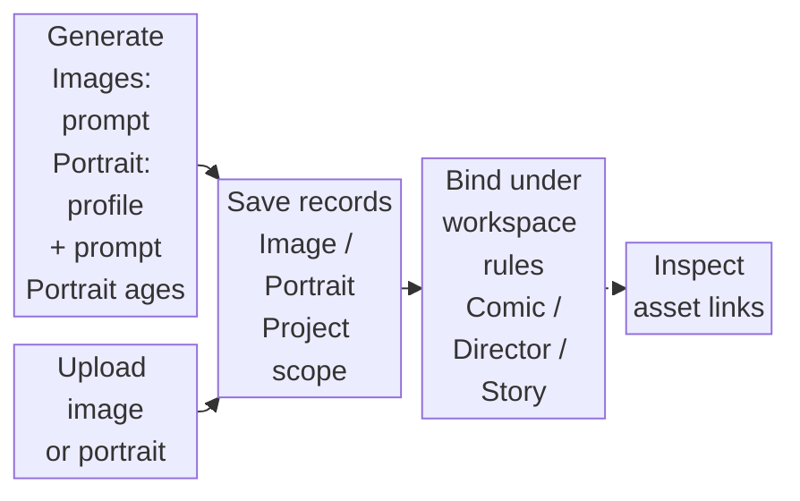

General images use custom prompts; portraits combine character profiles with portrait prompts. Images and portraits can also be uploaded, retaining project ownership and references. Character portraits support regeneration and age variants. Each workspace applies its asset-selection rules; saved bindings distinguish system references from user-added images.

### Comics

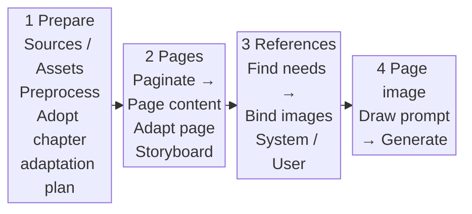

Stages retain structured artifacts and their sources; page storyboards cover panels, action, dialogue and narration. System references and user-added images are managed separately; reference discovery only identifies needs and matches existing assets. Delete an existing stage artifact before regenerating, with downstream effects previewed before deletion.

*This shows saved storyboards and the reference-needs check. Final page images remain at 0/2; no finished comic images were generated for this tour.*

### Chapter video

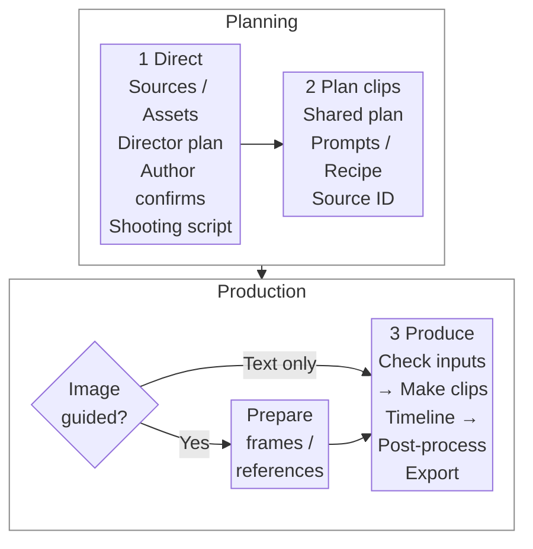

Edit director plans manually or with an Agent; formal confirmation remains an author action. Frames and clips share a segment plan, and first-frame chaining requires the preceding clip's tail frame. Upstream edits trigger dependency checks for affected segments. See [Director editing design](docs/public/director-native-editing.md) (Chinese).

*The director timeline combines shots, timing and image points. The bound image is a prepared illustration. The [complete tour](docs/public/workflow-tour.md) continues to the shooting script; this session did not generate a finished video.*

### Interactive stories

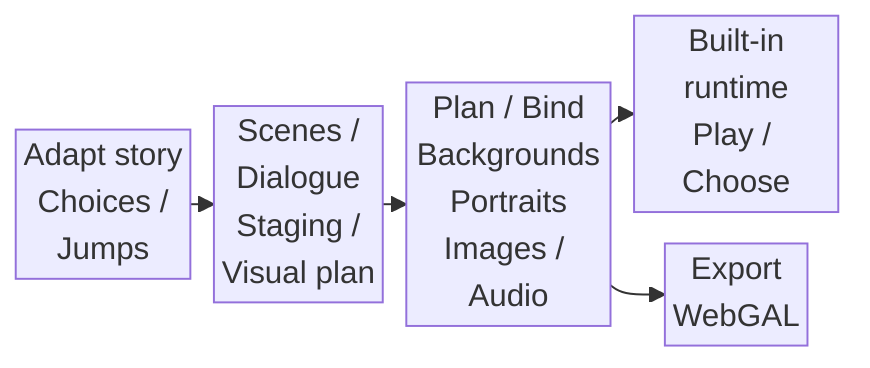

Edit scenes, lines, order and choices; plan or generate image assets and import audio. Playback and export use the saved story and its asset bindings.

*The same chapter becomes a story with choices. Inspect its branches on the left and edit node dialogue and options on the right.*

### Freeform canvas

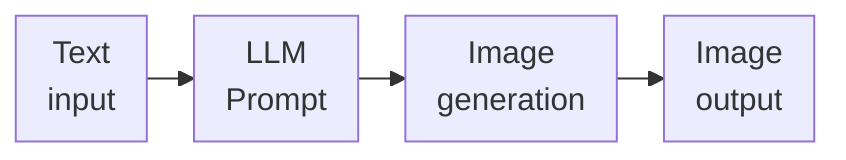

Media processing connects matching input types. This example trims video and extracts a frame:

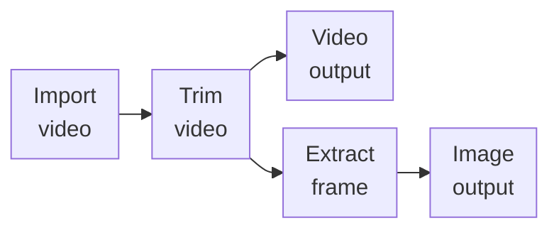

These are two possible workflows. Text, image, audio and video outputs have separate node types. Video generation requires a text prompt; prompt-only, first-frame, first-and-last-frame and reference-image modes have different input requirements. An image alone cannot replace the prompt. The canvas is an independent project. Its generation nodes currently serve freeform video projects; chapter-derived video uses the chapter workflow above.

*This independent canvas actually trimmed the prepared video, extracted a frame and saved its outputs. The status shows 4/4 execution nodes completed; the input node remains ready. This demonstrates media processing without calling a video-generation model.*

## Agents and automation

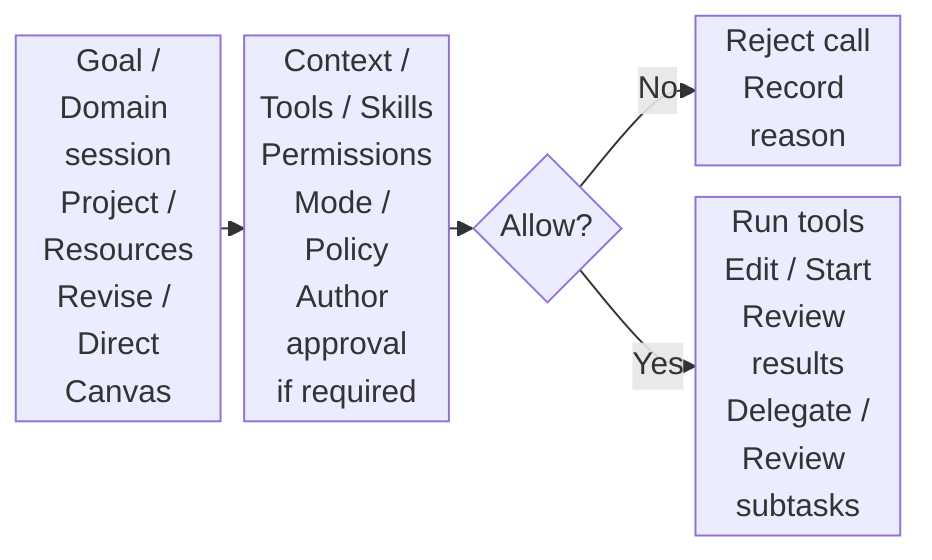

| Execution mode | Constraints on writes |
| --- | --- |
| Advice `advice_only` | Write tools are forbidden; read, analyze and suggest only |
| Review writes `review_writes` | Usually requires approval; `edit_article` only stores a reviewable patch and does not write chapter text |
| Autonomous `autonomous` | Permissions and tool policies still apply; some actions still need author approval |

Agent sessions expose tasks, pending approvals and cancellation of running tasks. The CLI also discovers commands, submits tasks and observes JSON/JSONL events. Adopting chapter patches and formally confirming director plans remain author actions. Available tools and modes depend on the workspace.

## Source synchronization

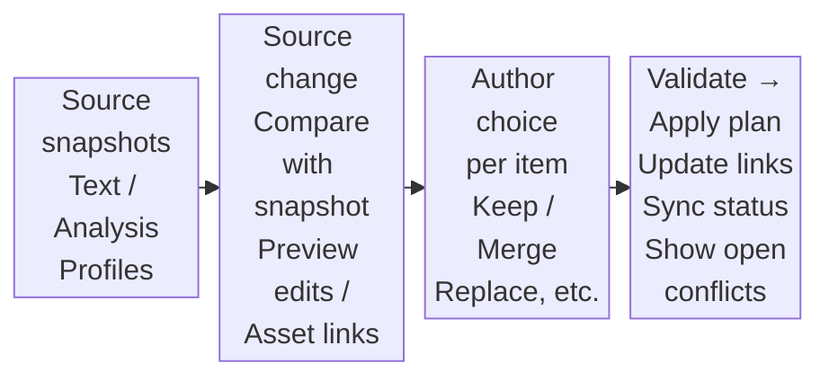

Snapshots identify the story version used for production. The asset dependency graph helps inspect sources and artifacts. Source changes do not silently overwrite local edits. Synchronization does not regenerate all media; supported regeneration strategies require an explicit choice, and detaching from the source has its own strategy. The freeform canvas does not thereby gain novel source snapshots.

*Adding a sentence to the novel produces one source change in the derived comic. This screenshot stops at comparison and strategy selection; synchronization has not been applied.*

## Collaboration and import / export

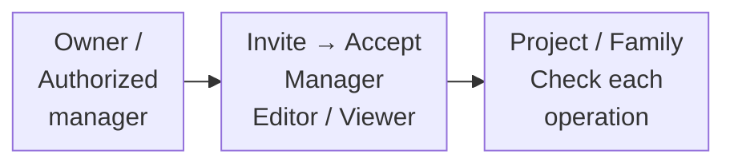

Delivering reading files and moving an editable project serve different purposes:

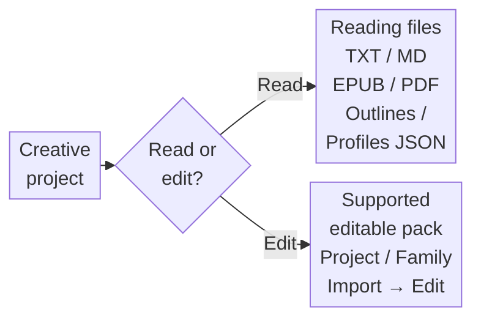

Member permissions apply to projects and related works. Reading files and editable project packages serve different purposes. Package exports include only the supported contents; complete backups still require both PostgreSQL data and media files.

*Delivery produces a local file: the TXT was actually downloaded and checked against the latest saved chapter in full.*

## Core design

### Shared business logic across entry points

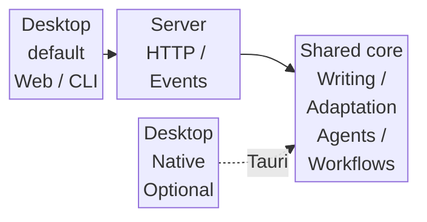

Shared Host API contracts constrain both entries. They define interfaces, rather than a separate running service. The Server uses Edge, Control and Runtime / Worker components. The next diagram shows only responsibilities and resources:

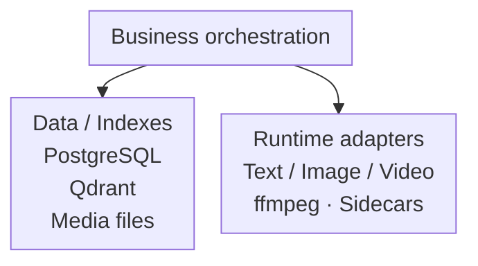

Arrows show calls or data flow, not direct Rust dependencies. API contracts, business rules, persistence and runtime adapters have separate owners. Enable optional capability packages as needed, and configure text, Embedding, image and video services separately. Models may use local services or external APIs.

### Recoverable tasks and version protection

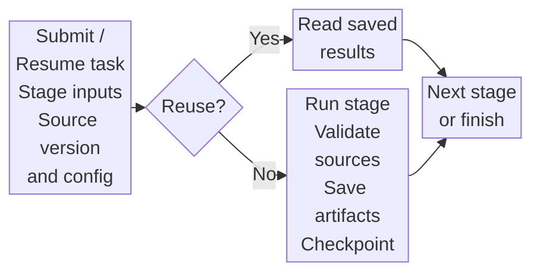

Recovery depends on the workflow and its state. If all stages already have valid results, the task can finish without executing more stages. Artifacts are saved under each stage's write rules; a checkpoint is not a formal artifact and cannot bypass version protection after chapters, outlines or sources change.

| Situation | Result |
| --- | --- |
| Execution failure or task cancellation | Keep explicit status and errors or cancellation reasons; retain completed stages as the workflow permits |
| Formal source version changes | Reject outdated writes and request a refresh or regeneration |
| Task recovery requested | Recheck checkpoints against current sources and inputs; not every state supports recovery |

See [Design evidence](docs/public/design-evidence.md) for code entry points and limits, and the [validation notes](docs/public/demo.md) for the public demo's narrower scope. The stack is Rust, Tauri 2, React/TypeScript, PostgreSQL/SeaORM and Qdrant.

## Get started

1. Follow the [source setup guide](docs/public/getting-started.en.md) to start the desktop or Web application.
2. Configure the models and services you need in settings.
3. Create a novel project, start with ideas and a blueprint, or enter / import existing chapters.
4. Save and analyze a chapter, check its profiles and feedback, then continue writing or create a multimedia work.

| Capability | What you need |
| --- | --- |
| Writing, analysis, optimization and Agents | A text model / API |
| Earlier-chapter retrieval | Embedding configuration and Qdrant |
| Images, portraits and comic pages | An image model / API or supported local service |
| Video generation and media processing | A video model / API; processing and assembly require ffmpeg and corresponding sidecars |
| Interactive stories | Scripts and related assets; playback and export conditions depend on the workspace |

Configure models and services in application settings; see the [configuration guide](docs/public/configuration.en.md). Formats, resolutions, durations and costs depend on the Provider.

## Common questions

**Do I pay for models?** A4N source is licensed under Apache 2.0. Third-party APIs, hosting and local inference hardware have their own costs. Check the separate licenses of models and assets.

**Can I use it offline?** External models receive the text, context or media needed for each request. To work offline, run the required models and services locally.

**Where is my work stored?** Structured data lives in the configured PostgreSQL database; media and runtime files live in the configured data directories. Back up both the database and files. The [configuration guide](docs/public/configuration.en.md) explains these boundaries.

**Can scripts or agents use it?** The `a4n` CLI connects to the same Server and offers command discovery, task observation and JSON/JSONL output. See the [CLI guide](docs/public/configuration.en.md#headless-cli).

## Development and feedback

Start with [Contributing](CONTRIBUTING.md); see [release notes](GITHUB_RELEASE.md) for the distinction between source checks, packaging and official distribution. These developer documents are currently in Chinese. For issues, include the version or commit, runtime mode and reproduction steps, with credentials and private content removed. Report security issues privately according to the [security policy](SECURITY.md).

[Apache License 2.0](LICENSE) · [中文版](README.md) · [Start your first story](docs/public/getting-started.en.md)
