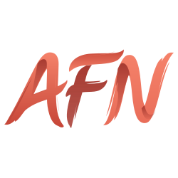
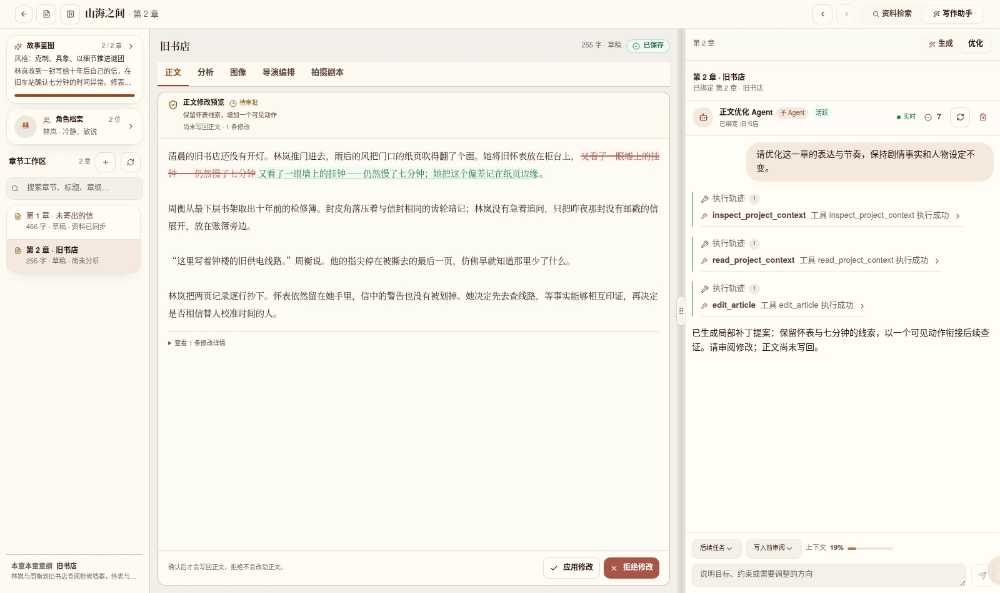
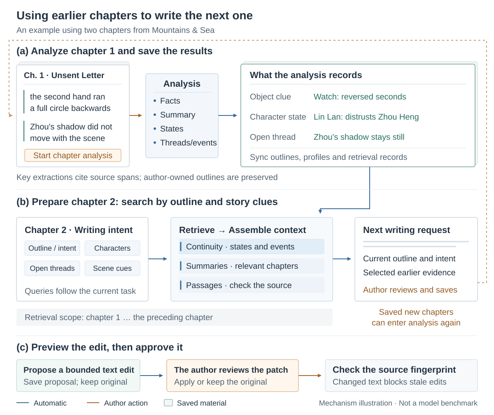
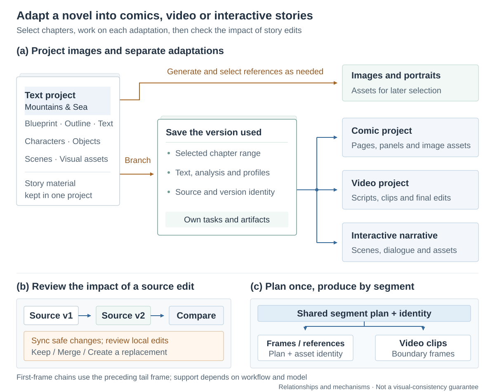
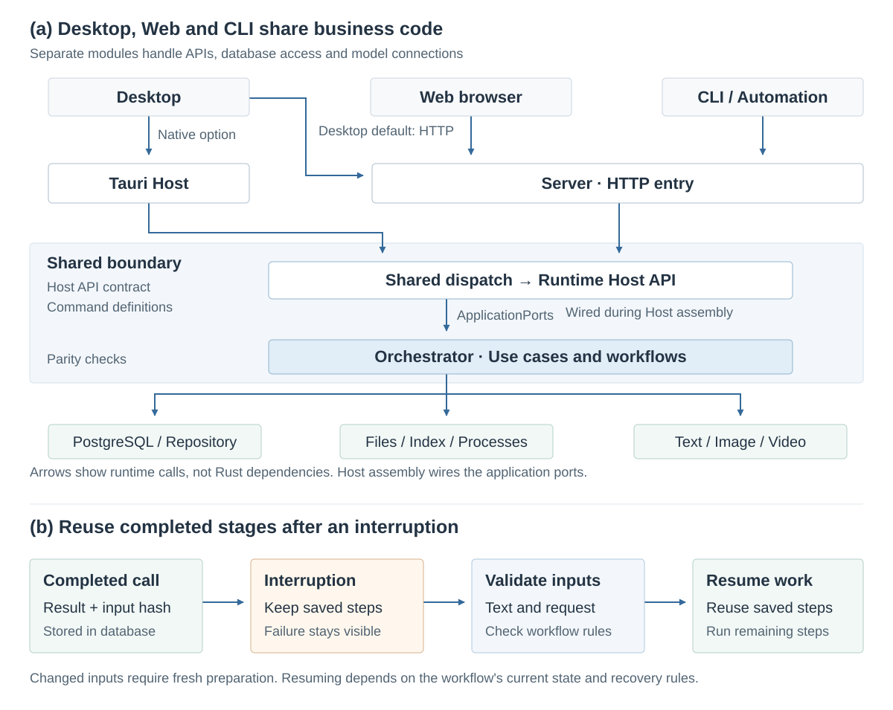

  

<h1 align="center">A4N</h1>

<strong>A local-first workspace for novels and multimodal creation, with a structured feedback loop</strong>

<a href="README.md">中文</a> · English

  <a href="docs/public/getting-started.en.md">Get started</a> ·
  <a href="docs/public/assets/demo.mp4">Watch / download demo</a> ·
  <a href="#core-design">Core design</a> ·
  <a href="https://github.com/GTJasonMK/A4N/issues">Report an issue</a>

A4N organizes creation around a story: inspiration, blueprints and chapters connect to character and scene profiles, images, comics, video and interactive narratives. Chapter analysis becomes searchable material for later writing. Content optimization produces changes for the author to review.

*Real application UI with the fictional project Between Mountains and Sea (山海之间). Click to watch or download the short demo. [Media and validation notes](docs/public/demo.md) distinguish prepared examples, simulated model responses and real application actions.*

> **Status: active development; run from source.** Initial setup requires a development environment and PostgreSQL. Configure your own models or APIs for AI features. There is currently no official Release installer.

## Built for ongoing creative work

- **Story memory with evidence.** Key extractions cite source text and analysis synchronizes reusable material. Later writing retrieves earlier chapters around the outline, characters and open threads, with continuity given priority.
- **Creative branches with provenance.** Images, comics, video and interactive narratives reuse story material. Derived projects retain source snapshots, so edits can be inspected before updating downstream work.
- **Reviewable, resumable workflows.** Optimization saves a patch for author approval. Supported workflows reuse completed stages when their input identities match.

## Core design

Open any diagram to view the full-size SVG.

### Story feedback: give the next chapter a foundation

Chapter analysis extracts facts, summaries, character states and foreshadowing in stages. Key results resolve source-span references to the original text. The workflow synchronizes retrospective outlines, character and object profiles, scene material and retrieval records while preserving existing author-owned outlines.

Before generating the next chapter, the system builds retrieval queries from the outline, writing intent, relevant characters and open threads, limited to **earlier chapters**. Context budgets organize the results into **continuity, summaries and source passages**. Optimization proposes bounded edits to text it has read; applying them requires author approval and a source-content check.

This is **feedback through story material and context**. It does not retrain the model or guarantee that every generated passage avoids continuity errors. The author still reviews the work. The watch clue in the figure is an illustrative example.

### Multimodal creation: one story, several forms

Images and portraits remain available in their project. Comic, video and interactive narrative projects work independently from **source snapshots** of the selected chapters. When source text, analysis or profiles change, the system can compare versions and identify affected work; locally edited outputs retain an author decision step.

Video frames and clips share a **segment plan and execution identity**. Reference assets must match the relevant plan, and first-frame chains connect later clips using the preceding clip's tail frame. Intermediate artifacts can be handled stage by stage; support depends on the chosen workflow and model.

*Prepared illustrative assets in a freeform video canvas. Chapter-derived video uses the derived project's chapter workflow; canvas generation nodes currently require a freeform video project.*

| What you want to create | What you need |
| --- | --- |
| Novel writing, analysis and optimization | A text model; retrieval feedback also needs Embedding configuration and Qdrant |
| Images, portraits and comic assets | A configured image model/API or a supported local generation service |
| Video generation and assembly | A video model/API; local media processing requires ffmpeg and the corresponding sidecars |
| Interactive narratives | Story scripts and related assets; export requirements depend on the target workspace |

Configure services in application settings; see [Configuration and local data](docs/public/configuration.en.md). Supported formats, resolutions, durations, prices and capabilities vary by provider.

## Get started

1. Follow the [source setup guide](docs/public/getting-started.en.md) to start the desktop or Web application.
2. Configure a text model and Embedding in settings. Add image and video services as needed.
3. Create a novel project, prepare its blueprint and chapter outline, then write or import the first chapter.
4. Start chapter analysis, inspect the synchronized profiles and threads, then continue writing or review optimization suggestions.

The guide includes a fictional example and completion checks. Installation commands, initial account setup and troubleshooting are maintained there.

## Engineering for long creative workflows

The desktop uses a local Server by default; Native mode uses the Tauri entry point. Browser and CLI requests also enter the shared Host API. Command contracts, workflow orchestration, data consistency and capability adapters have distinct owners.

Long workflows retain stage results and input fingerprints. After interruption, supported workflows validate the inputs, reuse completed calls and continue remaining steps. If formal story material changes during chapter generation, results based on the older inputs are rejected.

| Design | Benefit | Implementation / checks |
| --- | --- | --- |
| Shared Host contract | Common business command definitions across entry points | [Host API contract](crates/host/a4n-api-contract), [parity checks](frontend/package.json) |
| Reviewable patches and conflict checks | Stale suggestions cannot directly overwrite newer text | [Patch rules and tests](crates/host/a4n-orchestrator/src/optimize/tests/patch_flow.rs) |
| Workflow checkpoints | Reuse completed steps when recovery conditions permit | [Chapter analysis recovery](crates/host/a4n-orchestrator/src/chapter_analysis/workflow/checkpoint.rs) |
| Project sources and snapshots | Compare source changes and preserve decisions for edited work | [Source differences](crates/platform/a4n-db/src/source_sync/snapshots), [decision guards](crates/platform/a4n-db/src/source_sync/decisions/guards.rs) |

See [Design evidence](docs/public/design-evidence.md) for implementation links and scope, and [Media and validation notes](docs/public/demo.md) for the workflow exercised here. The stack uses Rust, Tauri 2, React/TypeScript, PostgreSQL/SeaORM and Qdrant. See the [contribution guide](CONTRIBUTING.md) (Chinese) for module responsibilities and development commands.

## Common questions

**Do I pay for models?** A4N source is licensed under Apache 2.0. Third-party APIs, hosting and local inference hardware have their own costs. Check the separate licenses of models and assets.

**Does local-first mean fully offline?** You configure data storage and runtime services. External models receive the text, context or media required for their requests. Offline creation depends on locally deployed services that support the required capabilities.

**Where is my work stored?** Structured data lives in the configured PostgreSQL database; media and runtime files live in the configured data directories. Back up both the database and files. The [configuration guide](docs/public/configuration.en.md) explains these boundaries.

**Can scripts or agents use it?** The `a4n` CLI connects to the same Server and offers command discovery, task observation and JSON/JSONL output. See the [CLI guide](docs/public/configuration.en.md#headless-cli).

## Development and feedback

Start with [Contributing](CONTRIBUTING.md); see [release notes](GITHUB_RELEASE.md) for the distinction between source checks, packaging and official distribution. These developer documents are currently in Chinese. For issues, include the version or commit, runtime mode and reproduction steps, with credentials and private content removed. Report security issues privately according to the [security policy](SECURITY.md).

[Apache License 2.0](LICENSE) · [中文版](README.md) · [Start your first story](docs/public/getting-started.en.md)
