

  

<h1 align="center">A4N</h1>

<strong>From novel writing to comics, video and interactive stories</strong>

<a href="README.md">中文</a> · English

  <a href="docs/public/getting-started.en.md">Get started</a> ·
  <a href="docs/public/assets/demo.mp4">Watch / download demo</a> ·
  <a href="#a4n-at-a-glance">Features</a> ·
  <a href="#creative-workflows">Workflows</a> ·
  <a href="#core-design">Core design</a> ·
  <a href="https://github.com/GTJasonMK/A4N/issues">Report an issue</a>

A4N brings novel writing, story knowledge and multimedia adaptation into one creative system. Start from an idea or import an existing work, develop its blueprint, outlines, chapters and profiles, then make comics, videos or interactive stories.

> A4N is still in development and currently runs from source. There is no official installer. Setup requires a development environment, PostgreSQL and your own model or API configuration.

## A4N at a glance

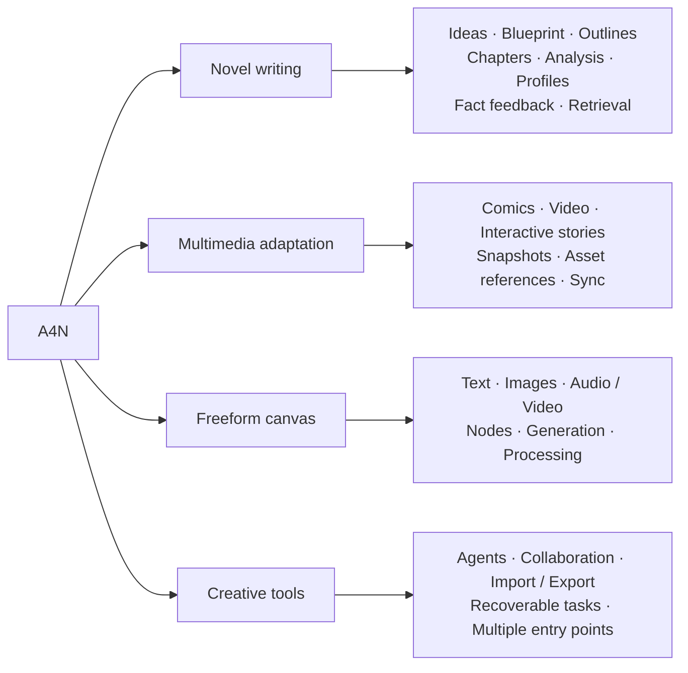

| What you want to understand | Start here |
| --- | --- |
| Write a novel and keep earlier material organized | [Novel writing](#novel-writing) · [Analysis and fact feedback](#analysis-and-fact-feedback) |
| Prepare images, portraits and production assets | [Images and portraits](#images-and-portraits) |
| Adapt a story into another medium | [Comics](#comics) · [Chapter video](#chapter-video) · [Interactive stories](#interactive-stories) |
| Connect generation and media-processing steps | [Freeform canvas](#freeform-canvas) · [Agents and automation](#agents-and-automation) |
| Manage source changes, collaborators and delivery | [Source synchronization](#source-synchronization) · [Collaboration and import / export](#collaboration-and-import--export) |
| Understand the system and task recovery | [Core design](#core-design) · [Get started](#get-started) |

View the writing desk and a 50-second walkthrough

*The example project Between Mountains and Sea (山海之间). Click the screenshot for a 50-second walkthrough. The demo uses a fictional story, prepared assets and simulated model responses; see the [media notes](docs/public/demo.md).*

## Creative workflows

The diagrams follow the creative stages. Edit manually, generate individual steps or inspect saved results without running an entire chain at once.

### Novel writing

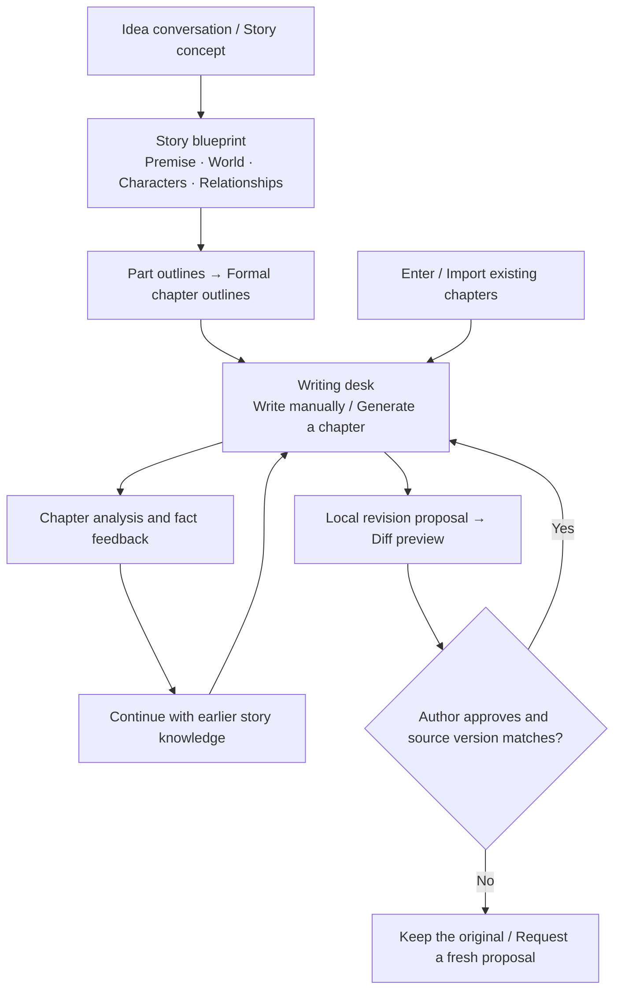

Blueprints, outlines, chapters and profiles can be inspected and edited. Local revisions show the original and proposed text before approval; outdated proposals cannot overwrite changed source text.

### Analysis and fact feedback

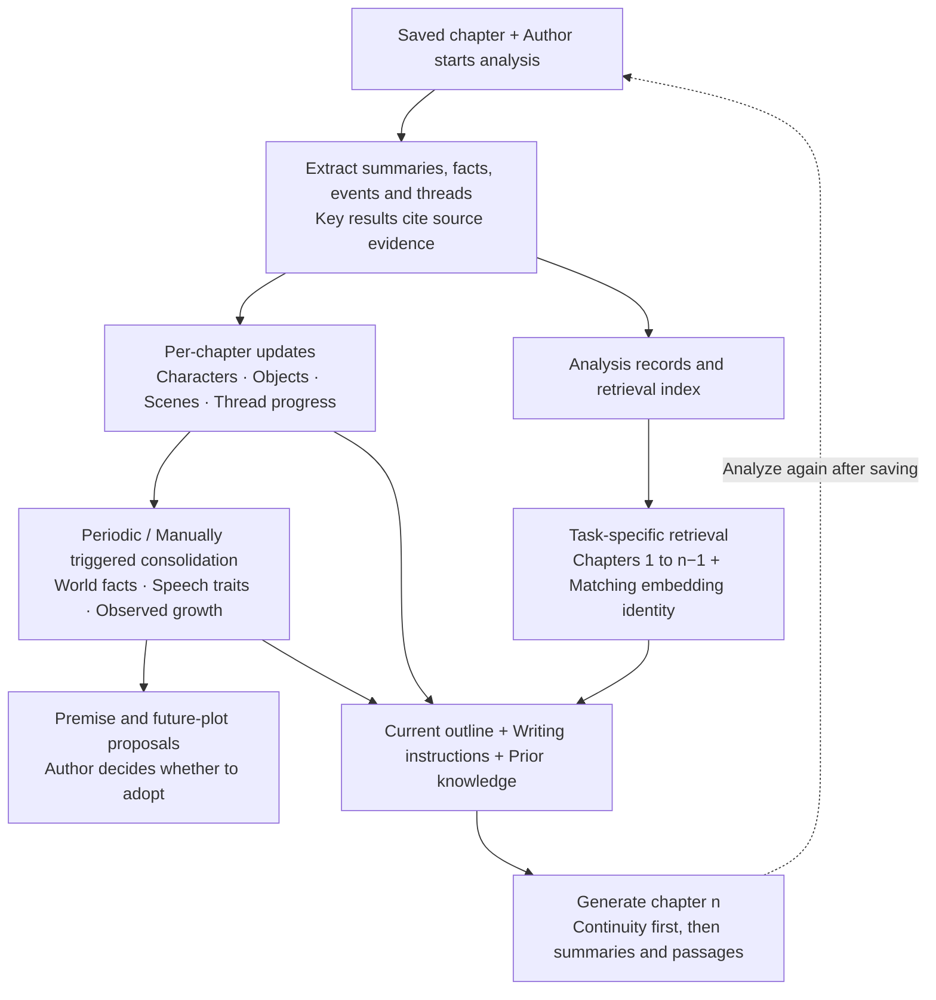

Less frequent updates consolidate after 5 distinct chapters by default; the interval is configurable, and important world-rule changes can trigger earlier consolidation. Formal outlines are preserved; missing outlines receive retrospective ones. Editing old chapters retracts invalid sources while preserving later manual changes. Saving alone makes no model call. See [Fact feedback](docs/public/fact-feedback.zh.md) (Chinese) and the [feedback example](docs/public/assets/self-feedback.en.svg). This manages writing context; it does not retrain the model.

### Images and portraits

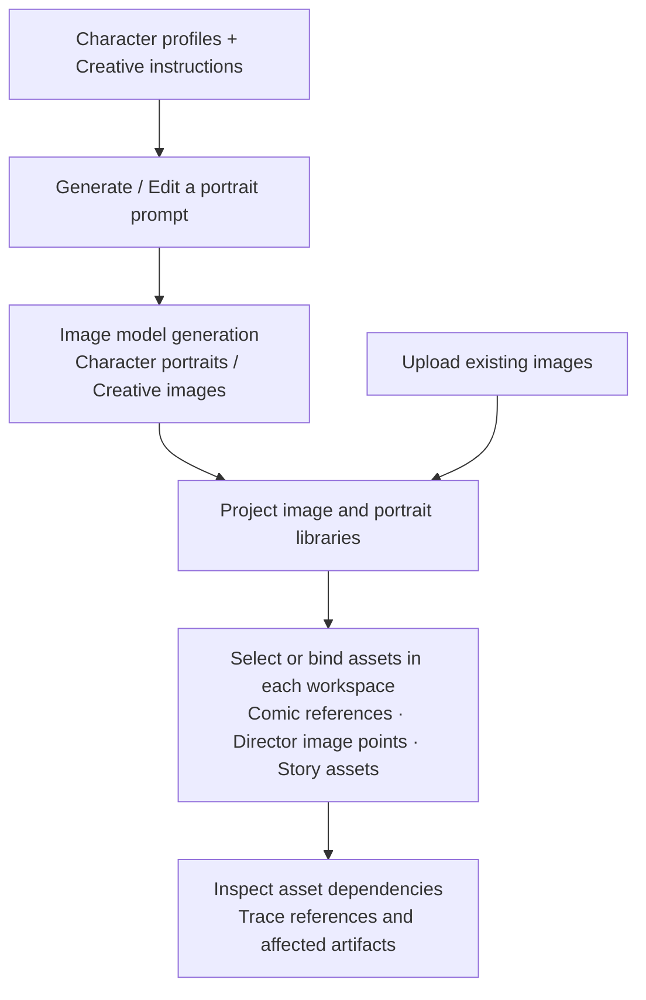

Generate or upload images and portraits with project ownership and references retained. Character portraits support regeneration and age variants. Each workspace applies its asset-selection rules; saved bindings distinguish system references from user-added images.

### Comics

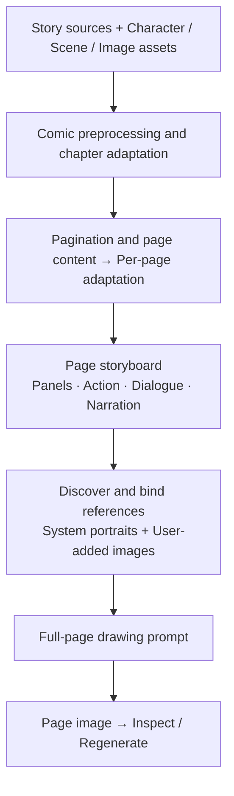

Stages retain structured artifacts and their sources. Inspect, edit or delete a selected stage, with downstream effects previewed before deletion. System references and user-added images are managed separately.

### Chapter video

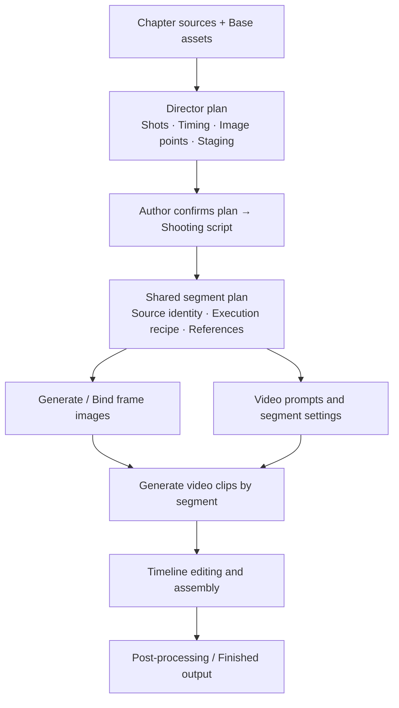

Edit director plans manually or with an Agent; formal confirmation remains an author action. Frames and clips share a segment plan, and first-frame chaining requires the preceding clip's tail frame. Upstream edits trigger dependency checks for affected segments. See [Director editing design](docs/public/director-native-editing.md) (Chinese).

### Interactive stories

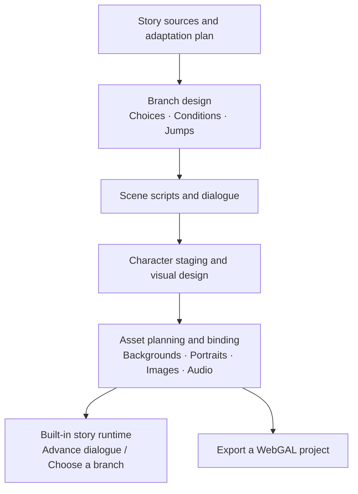

Edit scenes, lines, order and choices; plan or generate image assets and import audio. Playback and export use the saved story and its asset bindings.

### Freeform canvas

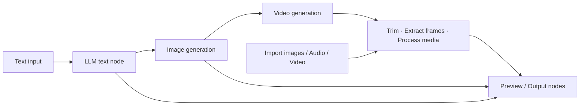

This is an example of connected steps, not a requirement to run every node. The canvas is an independent project. Canvas generation nodes currently serve freeform video projects; chapter-derived video uses the chapter workflow above.

View a freeform canvas example

[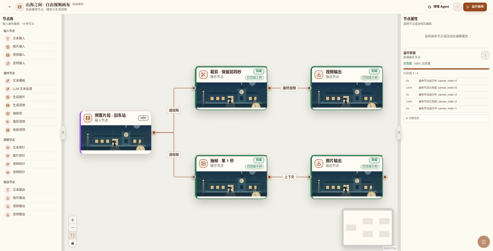](docs/public/assets/multimodal-workspace.webp)

The example uses prepared video to show media processing; it does not demonstrate a call to a video-generation model.

## Agents and automation

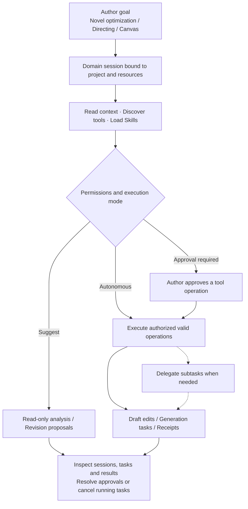

Agents can use project tools and handle long-running tasks. The CLI also discovers commands, submits tasks and observes JSON/JSONL events. Adopting chapter patches and formally confirming director plans remain author actions. Available tools and modes depend on the workspace.

## Source synchronization

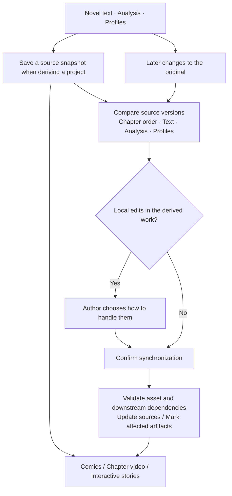

Snapshots identify the story version used for production. The asset dependency graph helps inspect relationships between sources and artifacts. Source changes do not silently overwrite local edits. The freeform canvas does not thereby gain novel source snapshots. See the [multimedia source example](docs/public/assets/multimodal.en.svg).

## Collaboration and import / export

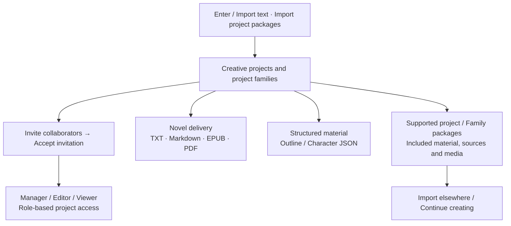

Member permissions apply to projects and related works. Reading files and editable project packages serve different purposes. Package exports include only the supported contents; complete backups still require both PostgreSQL data and media files.

## Core design

### Shared business logic across entry points

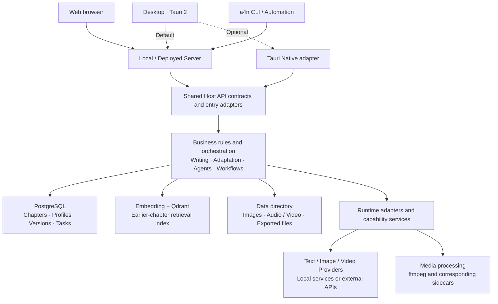

Arrows show calls or data flow, not direct Rust dependencies. API contracts, business rules, persistence and runtime adapters have separate owners. Enable optional capability packages as needed, and configure text, Embedding, image and video services separately. See the more detailed [architecture example](docs/public/assets/architecture.en.svg).

### Recoverable tasks and version protection

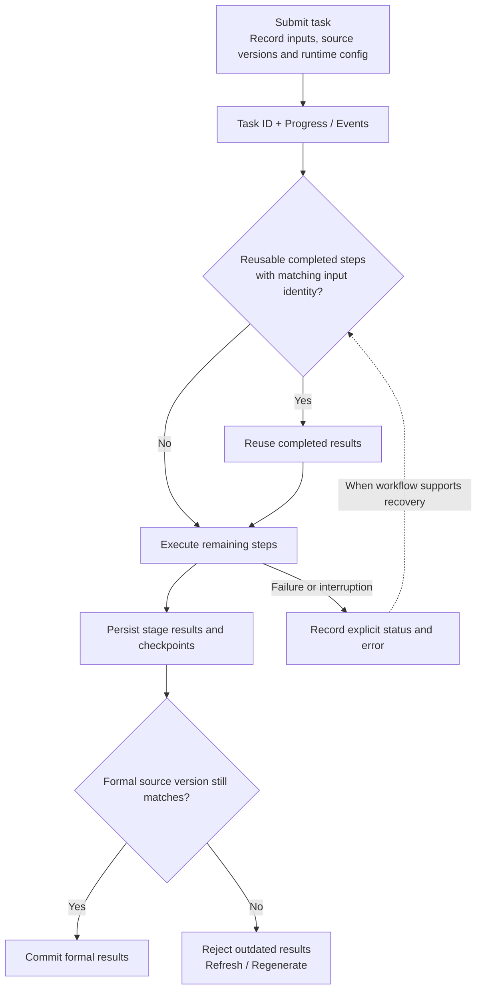

Recovery depends on the workflow and its current state. Checkpoints cannot bypass version checks after chapters, outlines or sources change. Failures, cancellations and conflicts have explicit outcomes.

See [Design evidence](docs/public/design-evidence.md) for code entry points and limits, and the [validation notes](docs/public/demo.md) for the public demo's narrower scope. The stack is Rust, Tauri 2, React/TypeScript, PostgreSQL/SeaORM and Qdrant.

## Get started

1. Follow the [source setup guide](docs/public/getting-started.en.md) to start the desktop or Web application.
2. Configure the models and services you need in settings.
3. Create a novel project, start with ideas and a blueprint, or enter / import existing chapters.
4. Save and analyze a chapter, check its profiles and feedback, then continue writing or create a multimedia work.

| Capability | What you need |
| --- | --- |
| Writing, analysis, optimization and Agents | A text model / API |
| Earlier-chapter retrieval | Embedding configuration and Qdrant |
| Images, portraits and comic pages | An image model / API or supported local service |
| Video generation and media processing | A video model / API; processing and assembly require ffmpeg and corresponding sidecars |
| Interactive stories | Scripts and related assets; playback and export conditions depend on the workspace |

Configure models and services in application settings; see the [configuration guide](docs/public/configuration.en.md). Formats, resolutions, durations and costs depend on the Provider.

## Common questions

**Do I pay for models?** A4N source is licensed under Apache 2.0. Third-party APIs, hosting and local inference hardware have their own costs. Check the separate licenses of models and assets.

**Can I use it offline?** External models receive the text, context or media needed for each request. To work offline, run the required models and services locally.

**Where is my work stored?** Structured data lives in the configured PostgreSQL database; media and runtime files live in the configured data directories. Back up both the database and files. The [configuration guide](docs/public/configuration.en.md) explains these boundaries.

**Can scripts or agents use it?** The `a4n` CLI connects to the same Server and offers command discovery, task observation and JSON/JSONL output. See the [CLI guide](docs/public/configuration.en.md#headless-cli).

## Development and feedback

Start with [Contributing](CONTRIBUTING.md); see [release notes](GITHUB_RELEASE.md) for the distinction between source checks, packaging and official distribution. These developer documents are currently in Chinese. For issues, include the version or commit, runtime mode and reproduction steps, with credentials and private content removed. Report security issues privately according to the [security policy](SECURITY.md).

[Apache License 2.0](LICENSE) · [中文版](README.md) · [Start your first story](docs/public/getting-started.en.md)
