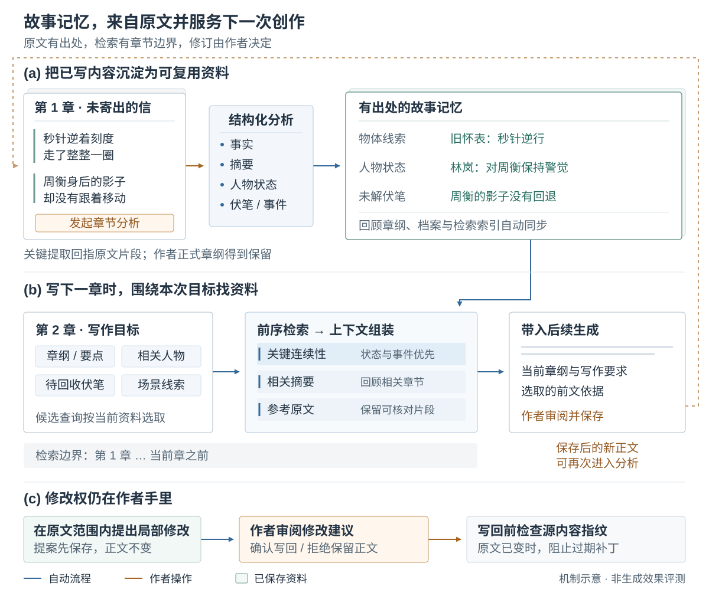
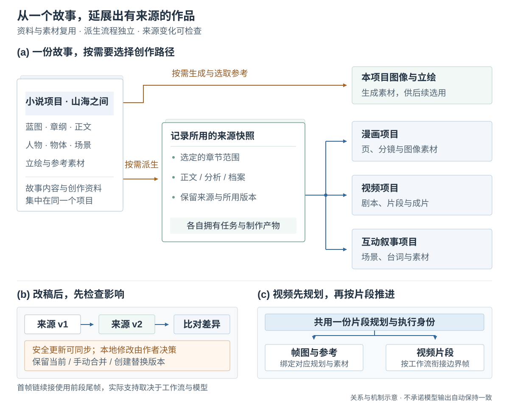
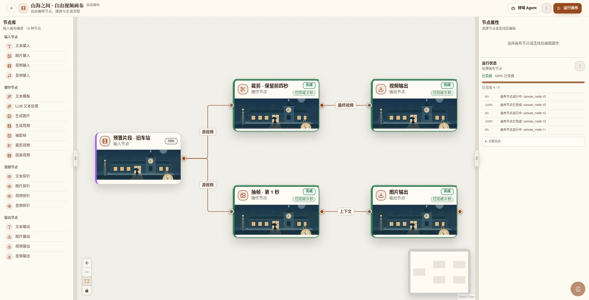
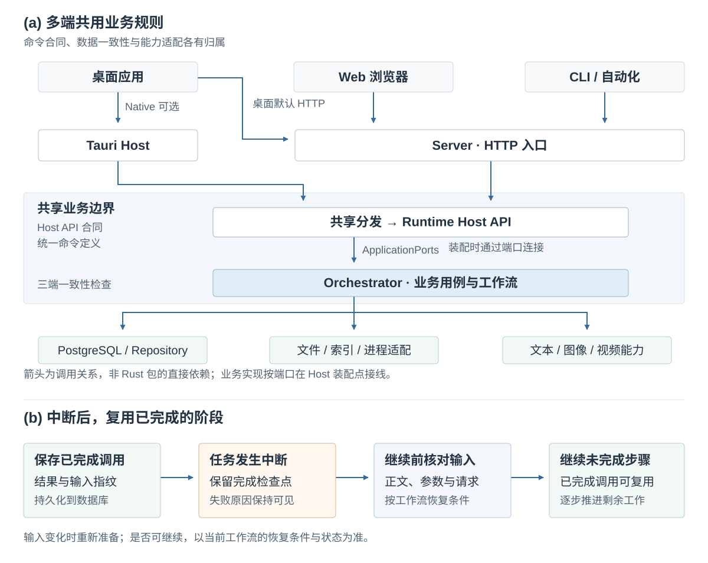

  

<h1 align="center">A4N</h1>

<strong>小说写作与漫画、视频制作</strong>

中文 · <a href="README.en.md">English</a>

  <a href="docs/public/getting-started.zh.md">快速开始</a> ·
  <a href="docs/public/assets/demo.mp4">观看 / 下载演示</a> ·
  <a href="#核心设计">核心设计</a> ·
  <a href="https://github.com/GTJasonMK/A4N/issues">反馈问题</a>

A4N 用来写小说、整理人物和场景资料，也支持制作漫画、视频和互动故事。你可以从灵感和大纲开始，也可以导入已有章节。分析过的内容会保存下来，生成下一章时再按需要检索。

*《山海之间》演示项目。点击截图观看 50 秒操作演示。演示使用虚构故事、预置素材和模拟模型响应，详见[素材说明](docs/public/demo.md)。*

> 项目仍在开发，目前需要从源码运行，尚无正式安装包。首次启动需要开发环境和 PostgreSQL，模型或 API 由你自行配置。

## 核心设计

点击方法图可打开原尺寸 SVG，查看细节。

### 章节分析与自反馈

写完一章，在“分析”页签启动分析任务，A4N 会提取事实、摘要、人物状态和伏笔。关键提取结果附带原文引用，便于核对。随后，程序更新人物、物体和场景档案、补充回顾章纲，并建立检索索引；已有的正式章纲会保留。

生成下一章前，A4N 按章纲、写作要求、相关人物和未回收伏笔查找前文。检索只覆盖当前章之前的内容。提供给模型的资料优先保留人物状态与事件，再加入相关摘要和原文片段。

写作助手还可以提出局部修改，界面会显示改前和改后的文字。你确认后才会修改正文；如果原文已经变了，程序会拒绝套用旧建议。

*图中是虚构故事的示例。这里的“自反馈”用于准备写作上下文，不会重新训练模型。分析和生成结果仍需核对。*

### 图片、漫画、视频与互动故事

图片和立绘保存在小说项目里。制作漫画、视频或互动故事时，可以选择章节，创建单独的派生项目。A4N 会保存制作时使用的正文、分析和档案版本，这份记录称为“来源快照”。

原稿改动后，你可以对比新旧版本，查看哪些内容受影响。如果派生内容也改过，程序会要求你选择如何处理。

视频按片段规划制作。帧图和视频使用同一份计划，程序会检查它们与所引用的素材是否对应。首帧串联模式会把前一段的尾帧用于下一段；具体支持哪些输入，取决于所选工作流和模型。

*自由视频画布示例：导入一段预置视频，裁剪并抽帧。画布中的生成节点目前只支持自由视频项目；章节派生视频从派生项目的章节工作流生成。*

| 想做什么 | 需要准备什么 |
| --- | --- |
| 小说写作、分析、内容优化 | 文本模型；检索反馈另需 Embedding 配置与 Qdrant |
| 图片、立绘、漫画素材 | 已配置的图片模型/API，或对应的本地生成服务 |
| 视频生成与成片 | 视频模型/API；本地媒体处理需要 ffmpeg 及对应 sidecar |
| 互动叙事 | 故事脚本与相关素材；导出目标及条件以对应工作台为准 |

模型和服务在应用设置中配置，见[配置指南](docs/public/configuration.zh.md)。可用格式、分辨率、时长和价格以具体服务为准。

## 快速开始

1. 按[源码运行指南](docs/public/getting-started.zh.md)准备环境并启动桌面端或 Web 端。
2. 在设置中配置文本模型和 Embedding；图片、视频服务按需要添加。
3. 创建小说项目，准备蓝图和章纲，录入或导入第一章。
4. 发起章节分析，查看档案、伏笔与资料同步结果，再继续写作或审阅优化建议。

指南包含安装命令、首次账号配置、示例正文和排障说明，可以照着完成一次写作与分析。

## 后端与任务恢复

桌面默认连接本地 Server，也可以使用 Tauri Native 入口。网页和 CLI 通过 Server 调用同一套业务代码。接口定义、数据库读写和模型接入由各自的模块负责。

可恢复的任务会保存已完成步骤的结果和输入记录。中断后，如果输入仍然匹配，就可以继续处理剩下的步骤。生成期间若正文、章纲等正式资料变了，程序会拒绝按旧资料保存结果。

| 机制 | 具体行为 | 代码 |
| --- | --- | --- |
| 共享命令定义 | 桌面、网页和 CLI 使用同一份业务命令目录 | [Host API 合同](crates/host/a4n-api-contract)、[一致性检查](frontend/package.json) |
| 修改建议与冲突检查 | 写入前核对正文是否已经变动 | [补丁规则与测试](crates/host/a4n-orchestrator/src/optimize/tests/patch_flow.rs) |
| 任务检查点 | 在允许恢复时复用已完成步骤 | [章节分析恢复规则](crates/host/a4n-orchestrator/src/chapter_analysis/workflow/checkpoint.rs) |
| 来源快照 | 对比原稿变化，检查受影响内容 | [来源差异](crates/platform/a4n-db/src/source_sync/snapshots)、[决策保护](crates/platform/a4n-db/src/source_sync/decisions/guards.rs) |

各项功能的实现和限制见[设计依据](docs/public/design-evidence.md)，演示实际做了哪些验证见[验证说明](docs/public/demo.md)。项目使用 Rust、Tauri 2、React/TypeScript、PostgreSQL/SeaORM 和 Qdrant；开发命令见[贡献指南](CONTRIBUTING.md)。

## 常见问题

**需要支付模型费用吗？** A4N 源码采用 Apache 2.0。第三方 API、托管服务及本地模型的硬件成本由使用者承担；模型和素材自身的许可需分别确认。

**可以完全离线使用吗？** 选择外部模型时，请求所需的正文、上下文或媒体会发送到对应服务。要离线使用，需要在本地运行相应模型和服务。

**作品保存在哪里？** 结构化数据保存在配置的 PostgreSQL，媒体与本地运行数据保存在配置的数据目录。备份时需同时考虑数据库和文件；[配置指南](docs/public/configuration.zh.md)说明路径与边界。

**能通过脚本或 Agent 使用吗？** 内置 `a4n` CLI 连接同一 Server，提供命令发现、任务观察和 JSON/JSONL 输出。使用方式见[CLI 指南](docs/public/configuration.zh.md#无前端-cli)。

## 开发与反馈

从[贡献指南](CONTRIBUTING.md)开始；构建、打包及正式发布的边界见[发布说明](GITHUB_RELEASE.md)。问题反馈请附版本或提交、运行方式和可复现步骤，移除密钥与私人内容。安全问题按[安全策略](SECURITY.md)私下报告。

[Apache License 2.0](LICENSE) · [英文版](README.en.md) · [开始第一次创作](docs/public/getting-started.zh.md)
