

  

<h1 align="center">A4N</h1>

<strong>从小说创作到漫画、视频与互动故事</strong>

中文 · <a href="README.en.md">English</a>

  <a href="docs/public/getting-started.zh.md">快速开始</a> ·
  <a href="docs/public/assets/demo.mp4">观看 / 下载演示</a> ·
  <a href="#一眼了解-a4n">功能总览</a> ·
  <a href="#核心创作链路">创作链路</a> ·
  <a href="#核心设计">核心设计</a> ·
  <a href="https://github.com/GTJasonMK/A4N/issues">反馈问题</a>

A4N 把小说写作、故事资料管理和多媒体改编放在同一个创作体系里。你可以从灵感开始，也可以导入已有作品；逐步建立蓝图、大纲、正文和档案，再制作漫画、视频或互动故事。

> 项目仍在开发，目前需要从源码运行，尚无正式安装包。首次启动需要开发环境和 PostgreSQL，模型或 API 由你自行配置。

## 一眼了解 A4N

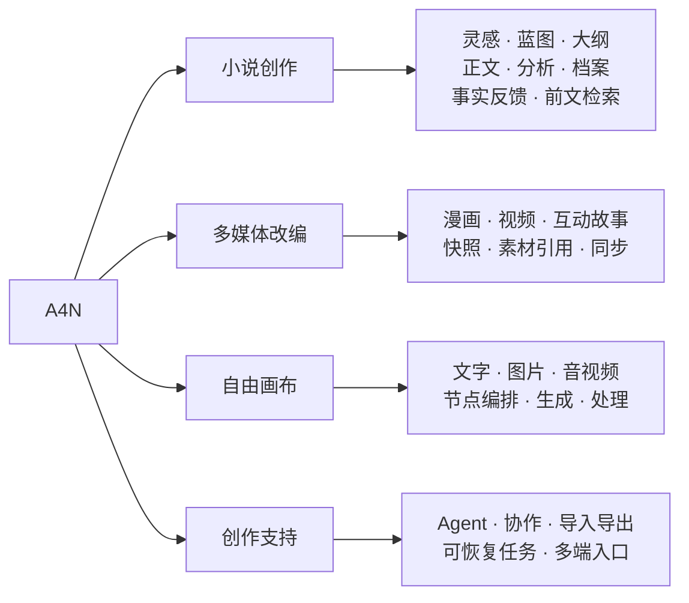

| 想了解什么 | 从这里看 |
| --- | --- |
| 从灵感写成小说，持续整理前文 | [小说写作](#小说写作) · [分析与事实反馈](#分析与事实反馈) |
| 准备图片、立绘与制作素材 | [图片与立绘](#图片与立绘) |
| 把故事制作成其他作品 | [漫画](#漫画) · [章节视频](#章节视频) · [互动故事](#互动故事) |
| 自己编排生成与素材处理步骤 | [自由画布](#自由画布) · [Agent 与自动化](#agent-与自动化) |
| 管理来源变化、团队和作品交付 | [来源同步](#来源同步) · [协作与导入导出](#协作与导入导出) |
| 了解系统如何运行和恢复任务 | [核心设计](#核心设计) · [快速开始](#快速开始) |

查看写作台截图与 50 秒操作演示

*《山海之间》演示项目。点击截图观看 50 秒操作演示。演示使用虚构故事、预置素材和模拟模型响应，详见[素材说明](docs/public/demo.md)。*

## 核心创作链路

下面的图按创作阶段展开。可以手工编辑、按需生成和查看已有结果，无需把整条链路一次跑完。

### 小说写作

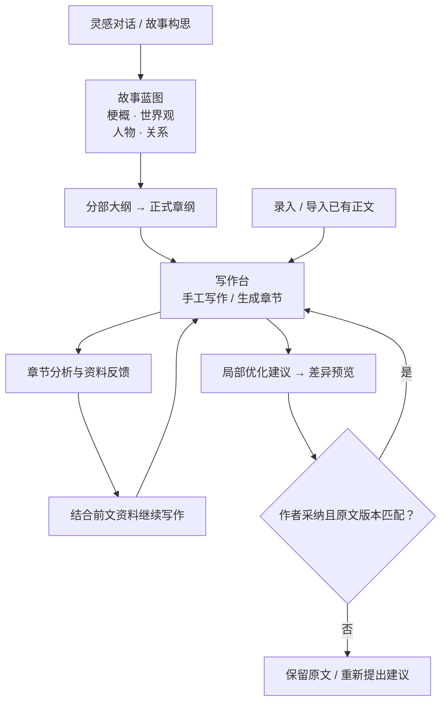

蓝图、大纲、章节和档案都可以查看与修改。局部优化先展示改前与改后内容，确认后才写回；旧提案不能覆盖已经变化的原文。

### 分析与事实反馈

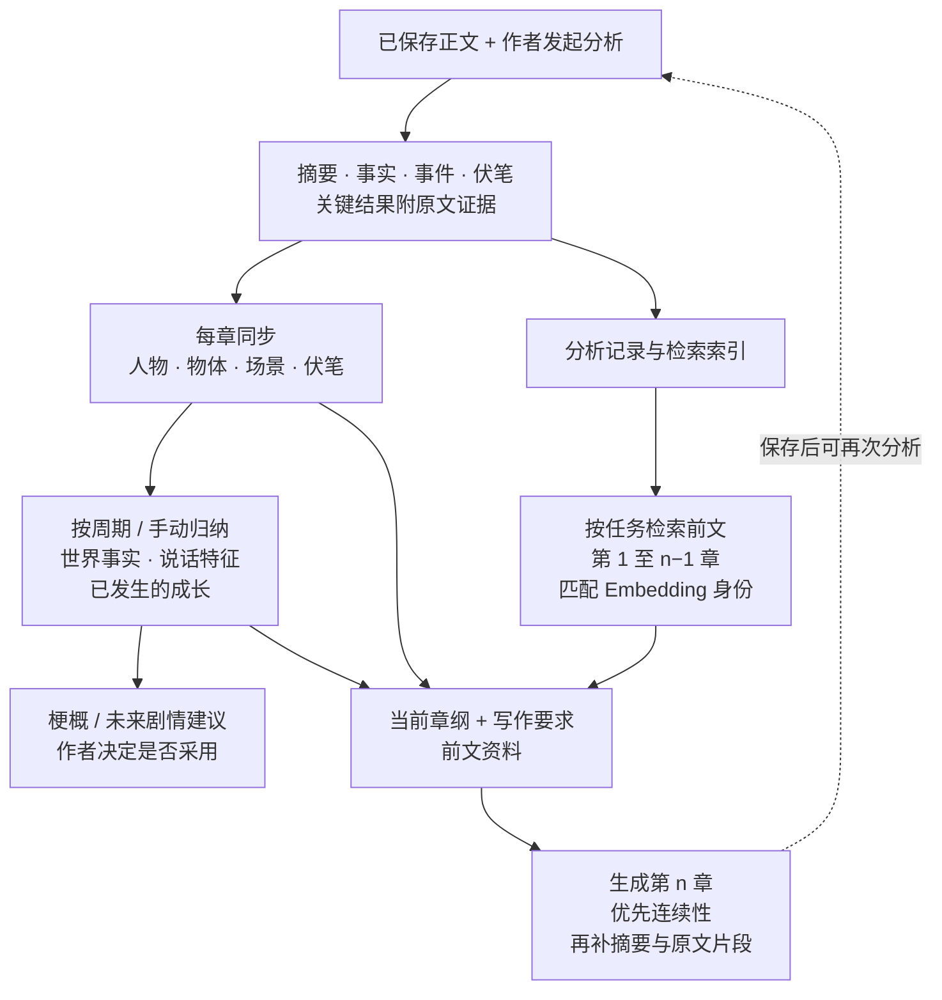

低频资料默认累计 5 个不同章节后归纳，可调整周期；重要世界规则变化等情况会提前触发。已有正式章纲保留，缺少时补充回顾章纲。修改旧章会撤回失效来源，保留后续手工修改；普通保存不会触发模型调用。详见[正文事实反馈](docs/public/fact-feedback.zh.md)与[反馈示例图](docs/public/assets/self-feedback.zh.svg)。这里的反馈用于管理上下文，不会重新训练模型。

### 图片与立绘

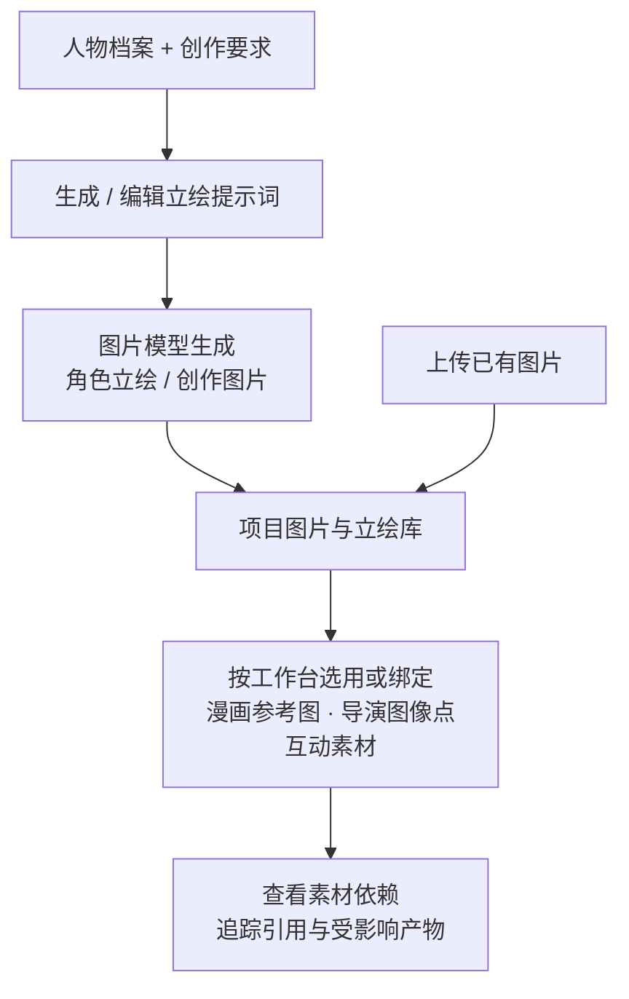

图片和立绘可以生成或上传，保留项目归属与引用关系。角色立绘支持重生成和年龄变体；各工作台按自身规则选择素材，系统参考图与用户添加图片按保存的绑定信息区分。

### 漫画

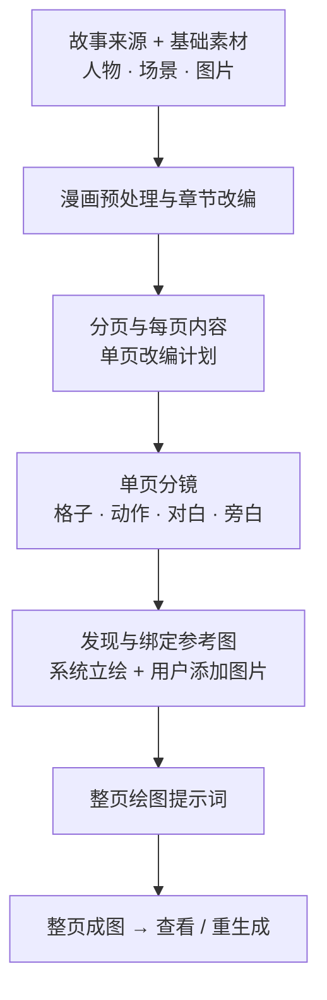

每一步保留结构化产物和来源。可以查看、编辑或删除指定阶段，删除前预览下游影响；系统参考图与用户添加图片分别管理。

### 章节视频

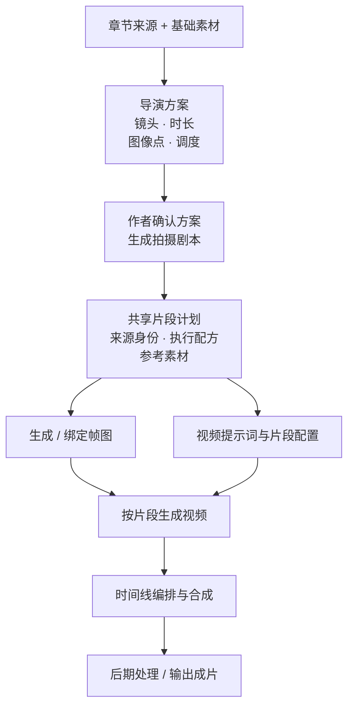

导演方案支持手工及 Agent 编辑，正式确认由作者完成。帧图与视频共用片段计划；首帧串联模式要求前一段尾帧。上游修改后检查对应片段的依赖关系，避免把旧素材直接用于新计划。详见[导演编辑设计](docs/public/director-native-editing.md)。

### 互动故事

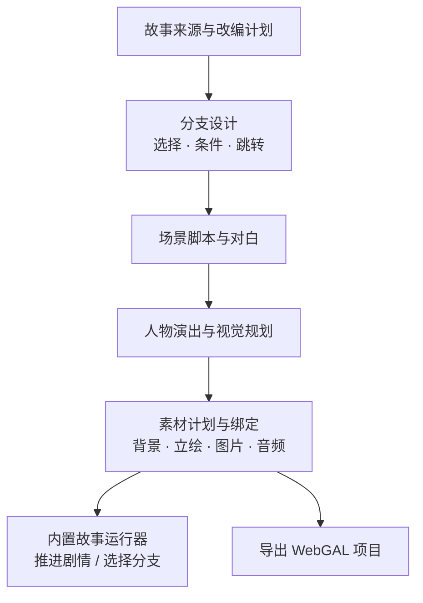

可以修改场景、台词、顺序和选项，规划或生成图像素材，并导入音频。运行器与导出使用已保存的故事及素材绑定。

### 自由画布

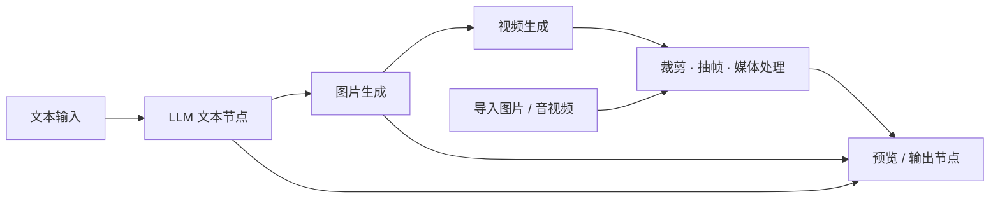

图中是可编排的示例，不要求所有节点都执行。自由画布是独立项目；当前画布生成节点用于自由视频项目，章节派生视频走上面的章节工作流。

查看自由画布示例

示例使用预置视频，展示素材处理，不代表实际调用了视频生成模型。

## Agent 与自动化

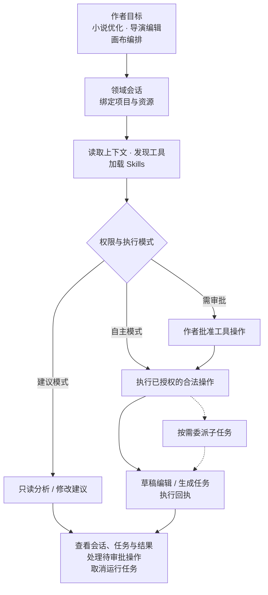

Agent 可以调用项目工具并处理长任务，CLI 也能发现命令、提交任务和观察 JSON/JSONL 事件。正文补丁采纳与导演方案正式确认仍由作者执行；不同领域的可用工具与操作模式以工作台为准。

## 来源同步

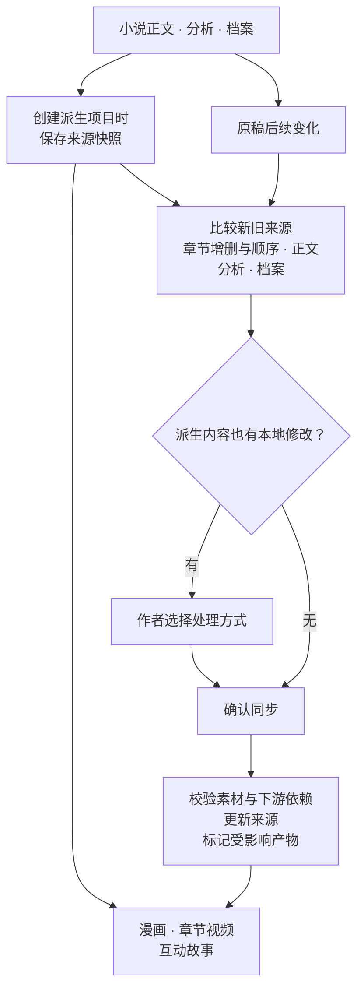

来源快照让“制作时用的是哪一版故事”可追溯。素材依赖图帮助查看来源和产物关系；原稿变化不会静默覆盖派生作品的本地编辑。自由画布不因此获得小说来源快照。见[多媒体来源示例图](docs/public/assets/multimodal.zh.svg)。

## 协作与导入导出

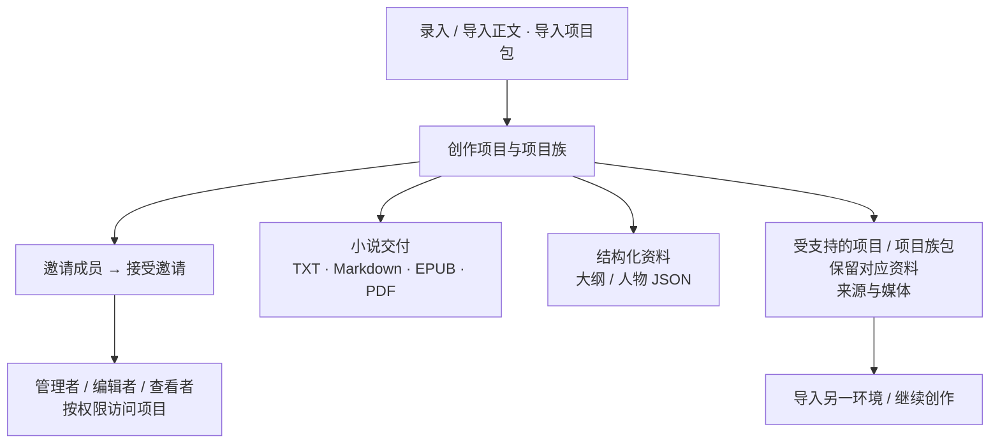

成员权限围绕项目及其关联作品管理。导出阅读文件与导出可继续编辑的项目包用途不同；项目包只包含相应功能支持的内容，完整备份仍需同时保存 PostgreSQL 数据和媒体文件。

## 核心设计

### 多端共用业务核心

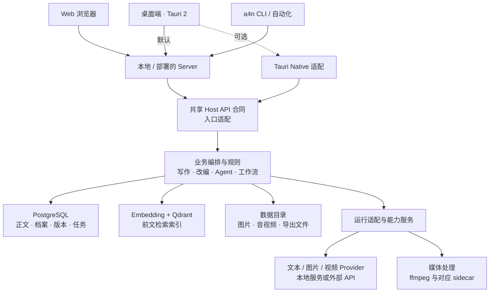

箭头表示调用或数据流，不是 Rust 直接依赖。接口合同、业务规则、数据访问和运行适配各有归属；可选能力包按需启用，文本、Embedding、图片和视频服务分别配置。更细的职责划分见[架构示例图](docs/public/assets/architecture.zh.svg)。

### 可恢复任务与版本保护

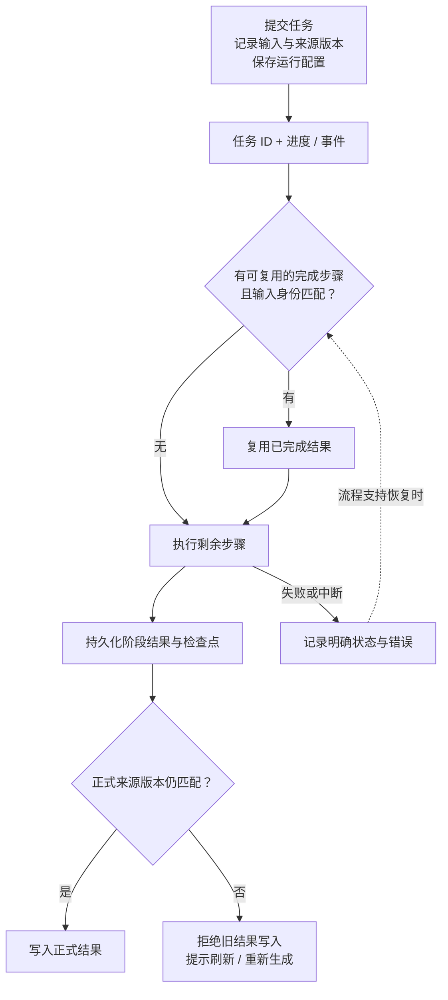

恢复能力取决于具体工作流和当前状态。正文、章纲或来源变化时，检查点不能绕过版本校验；失败、取消和冲突都有明确结果。

各图对应的代码入口与行为边界见[设计依据](docs/public/design-evidence.md)。公开演示的实际验证范围见[验证说明](docs/public/demo.md)。技术栈为 Rust、Tauri 2、React/TypeScript、PostgreSQL/SeaORM 和 Qdrant。

## 快速开始

1. 按[源码运行指南](docs/public/getting-started.zh.md)准备环境，启动桌面端或 Web 端。
2. 在设置中配置所需模型与服务。
3. 创建小说项目，从灵感与蓝图开始，或录入 / 导入已有章节。
4. 保存正文并发起分析，核对档案与反馈，再继续写作或创建多媒体作品。

| 要使用的能力 | 需要准备 |
| --- | --- |
| 小说写作、分析、内容优化、Agent | 文本模型 / API |
| 前文检索反馈 | Embedding 配置与 Qdrant |
| 图片、立绘、漫画成图 | 图片模型 / API 或支持的本地服务 |
| 视频生成与媒体处理 | 视频模型 / API；处理与合成需要 ffmpeg 及对应 sidecar |
| 互动故事 | 故事脚本与相关素材；运行、导出条件以工作台为准 |

模型和服务在应用设置中配置，见[配置指南](docs/public/configuration.zh.md)。格式、分辨率、时长和费用取决于实际 Provider。

## 常见问题

**需要支付模型费用吗？** A4N 源码采用 Apache 2.0。第三方 API、托管服务及本地模型的硬件成本由使用者承担；模型和素材自身的许可需分别确认。

**可以完全离线使用吗？** 选择外部模型时，请求所需的正文、上下文或媒体会发送到对应服务。要离线使用，需要在本地运行相应模型和服务。

**作品保存在哪里？** 结构化数据保存在配置的 PostgreSQL，媒体与本地运行数据保存在配置的数据目录。备份时需同时考虑数据库和文件；[配置指南](docs/public/configuration.zh.md)说明路径与边界。

**能通过脚本或 Agent 使用吗？** 内置 `a4n` CLI 连接同一 Server，提供命令发现、任务观察和 JSON/JSONL 输出。使用方式见[CLI 指南](docs/public/configuration.zh.md#无前端-cli)。

## 开发与反馈

从[贡献指南](CONTRIBUTING.md)开始；构建、打包及正式发布的边界见[发布说明](GITHUB_RELEASE.md)。问题反馈请附版本或提交、运行方式和可复现步骤，移除密钥与私人内容。安全问题按[安全策略](SECURITY.md)私下报告。

[Apache License 2.0](LICENSE) · [英文版](README.en.md) · [开始第一次创作](docs/public/getting-started.zh.md)
