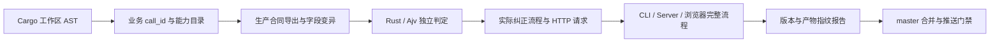

# 模型调用工程验收

模型调用测试覆盖文本、Agent 工具、图片、视频、Embedding 和配置探测，也包含画布素材与节点、图片视觉评估、Agent 历史压缩和 JSON 决策、联网搜索。全部使用确定性本地服务，不消耗真实模型额度。

通过验收表示：已登记的结构、协议、异常、纠正、任务恢复和媒体校验按用例正确执行，无效结果不能被测试冒充为成功。外部服务的可用性、真实模型遵守指令的能力和生成内容质量仍需要独立评估。



## 执行

在 debug 工作树中运行，构建缓存遵守调用者的 `CARGO_TARGET_DIR`。先按项目说明准备 Node.js 22、Rust、FFmpeg/FFprobe、ONNX Runtime、Qdrant、Chromium、Docker 和前端依赖。

```bash
# 日常开发：字段合同、协议适配器、生产校验和有限纠正。
python3 scripts/tests/run_test_matrix.py --profile model-fast

# 合并 master 前：先提交 debug，确认工作区干净，再执行完整验收。
python3 scripts/tests/run_test_matrix.py --profile model-full

# 使用 model-full 子目录中的报告进行复核。
python3 scripts/tests/run_test_matrix.py --verify-model-report data/test-runs/<run>/model-full/report.json
```

`model-full` 包含 `model-fast`、隔离 PostgreSQL 下的生产语义测试，以及原有完整创作 CLI/浏览器验收。Rust 编译与测试分开；每个后端测试组限制 60 秒。失败、超时、空集合、未执行、跳过或缺少证据均不能通过。

完整报告成功后，将报告路径登记到本地 Git 配置：

```bash
git config a4n.modelAcceptanceReport /absolute/path/to/model-full/report.json
git config core.hooksPath /absolute/path/to/work/debug/.githooks
```

仓库 hooks 检查 master 的提交、非快进合并和推送；推送检查也覆盖快进更新。候选 Git 内容树必须与验收版本一致。GitHub 的 `Model call contracts / model-acceptance` 检查应设为 master 的必需状态检查；本地 hooks 不替代远端分支保护。

## 合同与覆盖

| 边界 | 检查内容 |
| --- | --- |
| 文本输出 | 必填删除、类型、null、空值、嵌套对象、数组、枚举、范围、额外字段；缺少 `exit_state`、字符串 ID 等历史故障 |
| 提示词 | 合同在自定义装配后追加；可解析的冲突合同块或明确标记的 JSON 输出示例提前报错；预览、请求和纠正使用同一份 Schema |
| 传输 | 从生产能力目录枚举预设；实际 HTTP 请求的协议、认证、预算、Schema、模型参数、multipart 文件与参考图顺序 |
| 异常 | 鉴权、限流、服务错误、断流、无终止标记、拒绝、截断、空白正文和超时；最多一次输出纠正，不重复提交付费任务 |
| 图片 / 视频 | 支持及拒绝的输入组合、真实素材字节、空文件、伪造和损坏素材、无视频流、任务状态和清理能力 |
| Embedding | 批次、返回数量、维度、索引顺序、重复索引、非有限浮点数和模型身份 |
| 辅助模型 | 历史摘要覆盖边界、原始历史保留、JSON Agent 决策与真实工具执行、视觉输入字节；搜索模型终态、结构化来源、响应大小和超时 |
| 任务 | 使用已有业务测试与真实 CLI 检查断点、恢复、取消、引用、正式结果和文件 / 数据库一致性 |

字段类型、可省略和可空必须分别声明。必须输出的空对象不能用 `null` 或缺字段代替。模型原始响应与系统补全后的持久化对象分别拥有合同，例如漫画参考图响应携带素材 ID，系统随后补全图片路径。

合同保护块使用 `[A4N_OUTPUT_CONTRACT]`。自定义创作指令保持可编辑；旧的冲突字段声明需要修正，不会被静默覆盖。程序只检查机器可读声明及明确标注的 JSON 输出示例，不声称能机械理解任意自然语言。图片、视频的创意提示词不插入文本 JSON 输出要求，其请求、任务和媒体各自校验。

## 执行证据

业务清单在 [model_calls.json](../scripts/tests/model_calls.json)，AST 基线在 [model_call_sites.json](../scripts/tests/model_call_sites.json)。AST 扫描从 Cargo workspace 获取全部成员，并沿可唯一识别的包装函数继续寻找调用；它不替代 Rust 类型检查，也不把候选调用点数量当作业务调用覆盖率。

新增业务入口、分支、合同或适配器时，需要补齐清单和执行证据。AST 基线是生成产物，更新前审查新增调用；不得把调用随意挂到一个现有 suite 下就宣称覆盖。

每份报告保存实际测试二进制、生产合同、字段变异、适配器观察和完整流程产物。检查器从当前清单与合同重新推导必测用例，删除报告中的“必测项”和相应结果也不能伪造完整性。源码、提示词、测试、素材、配置、锁文件、构建选项、原生工具或二进制变化都会使旧证据失效。报告保存在忽略的 `data/` 中，不能提交测试数据库、密钥或生成素材。
