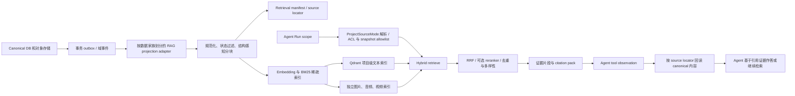

# A4N Agent RAG 系统设计方案

> 状态：待评审的设计提案；本文不包含实现改动。
> 日期：2026-10-22
> 设计依据：$agentdev 的 RAG、知识组织、记忆、上下文工程、工具设计和 Agent 评测规范。

## 1. 执行摘要

A4N 已有可复用的文本 RAG 底座：项目级索引、Qdrant dense 向量与 BM25 sparse 检索、RRF 融合、语义章节分块、内容 hash 增量同步，以及章节生成中的加权多查询。方案保留这套底座，逐步扩充数据源，并为 Agent 提供统一、受权限约束、可返回证据引用的检索能力。

设计重点：

1. **以业务数据和对象存储为事实源。** RAG 是定位证据的派生索引，不成为项目内容、权限或当前状态的第二套事实来源。
2. **按数据语义分路由。** 项目文本与叙事事实进入项目 RAG；图片、音视频进入多模态资产检索；用户偏好进入独立记忆域；Agent 执行轨迹进入运行诊断；精确状态和关系使用现有领域读取工具；密钥和配置不进入 RAG。
3. **搜索结果能回到原始对象。** 每个片段绑定项目、资源 ID、版本、hash 和文本位置/媒体时间码。Agent 先搜索，再按需读取完整原文并引用来源。
4. **项目隔离默认关闭跨项目搜索。** Text/standalone Comic/freeform Canvas 默认只查自身；派生 Comic/Video/Galgame 只额外读取经业务合同验证的冻结 source snapshot，不扩展到 root live 内容或兄弟项目。
5. **先建立效果基线，再调整算法。** 使用固定语料快照、相关性标注、拒答用例和真实 Agent 任务，分层评测召回、排序、证据质量、任务完成、安全、延迟和成本。

建议按“评测基线 → 接入现有文本数据 → 纳入生产内容类型 → 纳入多模态 → 影子与灰度”的顺序推进。暂不建议把所有 JSON、日志和对话逐条向量化，也不建议先引入覆盖全库的 GraphRAG。

## 2. 当前代码基线

- crates/platform/a4n-domain/src/rag.rs 已定义章节、摘要/元数据、关键事件、伏笔、大纲、蓝图、世界观、角色与状态、关系、场景等类型，整体偏向小说叙事数据。
- crates/host/a4n-orchestrator/src/context/rag/ingest.rs 的全量记录构建覆盖章节、大纲、蓝图、角色和场景；伏笔、角色状态和属性事件也有专门同步入口。
- crates/rag/a4n-rag-index/src/qdrant_store/store.rs 已执行 dense 与 BM25 检索，并通过 RRF 融合结果。crates/host/a4n-orchestrator/src/rag/search/enhanced/ 支持查询扩展、查询权重和章节时间权重。
- 章节 RAG 使用语义分块；桌面端本地 embedding 采用 prepare、客户端 embedding、带 hash 上传的流程。上传前核对 embedding 身份、chunk ID 和 canonical 文本 hash，并清理失效记录。
- 章节生成已有按写作目标生成的多查询检索路径；它属于生成流程内的 RAG 使用方式。
- Agent 的 search_project_context 目前是内容优化场景的工具，对已组装上下文做字符串包含匹配；从当前代码入口看，main/general Agent 尚无统一的项目 RAG 搜索工具。
- 漫画页面与分镜、视觉计划、媒体资产、音视频转录、画布/工作流产物，以及 Agent 长期记忆和执行轨迹，尚未形成共享的检索数据合同。

建议复用 RagDataType、RAG ports、Qdrant dense/BM25、embedding identity 和增量 hash 同步；增加统一投影、Agent 查询入口、证据读取合同和评测闭环，不再实现第二个向量库。

### 2.1 A4N 项目族的实际来源模式

A4N 的 project_kind 和 ProjectSourceMode 已定义不同的来源身份。项目族展示中的“属于同一根项目”不是一个可直接用作搜索范围的授权规则。

| project_kind / source mode | canonical 本地语料 | 允许读取的来源项目数据 |
|---|---|---|
| Text / Self | 当前文本项目及其自身的 source snapshots | 默认只读当前项目；历史 snapshot 需按历史/比较意图明确选择 |
| Comic / Standalone | 独立漫画项目自己的章节/页面和产物 | 不自动读取任何文本项目 |
| Comic / Derived | 漫画项目自身的 pipeline artifacts，加创建该项目时明确绑定的 source_snapshot_id | 只读该 source_snapshot_id 中的来源章节/设定；不读取根项目当前 live revision，也不读取兄弟漫画/其他派生项目 |
| Video / Derived、Galgame / Derived | 派生项目自己的 video segments、timeline 或 script/scenes/lines/choices，加其绑定的 source snapshot | 只读该项目通过 project family 验证的冻结 snapshot |
| Canvas / Freeform | 自由画布项目自己的 graph、text assets 和 artifacts | 只读取 graph 或 GenerationSpec 显式引用且通过项目资源授权的素材 |

数据库合同使用 root_project_id、source_snapshot_id 和 snapshot chapter ID 区分项目族及来源，并通过 project_source_snapshot_allowed / project family access 验证具体快照是否属于当前派生项目。派生项目能读“明确绑定的冻结来源”，并不等于能搜索根项目的实时内容。建议每个派生项目的检索语料由“本项目自己的产物 + 唯一绑定的只读 snapshot 投影”组成，result ref 同时记录检索归属 project 和 canonical 来源 project/snapshot。

这也决定了索引不能只放一个模糊的 project_id：root_project_id 表示 lineage，retrieval_project_id 表示本次搜索授权归属，source_snapshot_id/source_snapshot_chapter_id 表示实际证据版本。相同根项目、相同标题或相似文本都不能取代快照绑定校验。

### 2.2 可作为数据目录的现有业务合同

ProjectFamilyTransfer 中的 typed records 是 A4N 当前项目数据家族的一个具体目录：text core 包含 blueprint/version、part/chapter outline、chapter、protagonist/object/scene profile、scene occurrence/transition/entity state；snapshot 层保存 chapter/outline/profile snapshot、text anchor 和 profile evidence；authoring 层保存 visual plan、shooting script 和 authoring document；generation 层保存 GenerationSpec、text/entity/media refs、PromptArtifact、MediaAsset、MediaProvenance 和 media binding；fact feedback 层保存 material fact changes、foreshadowing、attribute events、state indexes、behaviors、deletion marks；Galgame/video 层保存 scripts/scenes/lines/choices、video segments、assembly timelines/clips 和 source-sync runs/conflicts/decisions；media 层也保存立绘、生成图片、漫画 prompt 和 manga pipeline artifact。

这些 transfer records 是数据盘点线索，不是建议直接把整包 JSON 喂进 embedding。索引应调用拥有数据的 canonical repository，用各自的 typed fields 生成小而可定位的 projection；包里的 before/after、request snapshot、文件路径和状态快照要按用途拆开并过滤敏感字段。

## 3. 目标与边界

### 3.1 目标

- Agent 能从有边界的项目范围内查到事实、原文、设定、规划记录和媒体候选。
- 检索结果能显示来源类型、版本、时间位置和完整原文读取方式。
- 支持精确名称/编号和语义问题，覆盖中文、别名、时间、跨章节和多模态查询。
- 数据写入、更新、删除和权限变化能驱动可观测、可重试、可重建的索引生命周期。
- RAG 改动能通过离线检索评测、Agent 端到端任务、权限测试和灰度指标证实收益。

### 3.2 不作为 RAG 的内容

- 精确状态、计数、当前 revision、生成任务状态、审批、访问控制、关系边和数据库约束：使用现有领域查询或结构化工具。
- 用户凭证、API key、加密配置、内部 token、进程环境、未脱敏错误上下文：禁止进入索引。
- 原始 Agent trace：保留为 append-only 可审计记录；按 run/时间/执行 ID 诊断。只有经确认、具备长期价值的事实或纠正才可提升为 memory 或项目知识。
- 外部文档里的命令和网页指令：只能作为引用数据，不能改变 Agent 系统指令或授权。

## 4. A4N 项目数据目录与检索策略

索引范围以“是否有助于 Agent 完成任务”和“是否能安全、准确地引用”为准，不以数据库表数量为准。每类数据都必须有 canonical source、访问范围、版本策略和回读接口。

| 数据家族 | A4N 数据示例 | 检索表示与默认路由 | 版本和范围注意事项 |
|---|---|---|---|
| 用户提供的原始素材 | 小说正文、导入文本、源章节快照、导入文档/附件 | 按章节、文档标题和段落/文本锚点切分；BM25 + dense；按 locator 回读原文 | 区分用户原文、外部来源和生成内容；保存 snapshot ID、hash、段落偏移和导入来源；旧快照仅用于比较/追溯 |
| 项目叙事事实与设定 | 蓝图、世界观、主角/角色档案、角色状态/属性事件、关系、场景、伏笔、关键事件 | 结构化事实按实体、关系或时间事件生成短记录；保留结构字段和可读表述。精确 ID/状态走领域读取，开放问题走 hybrid RAG | 使用现有 entity ID 和关联边，不从文本相似度推断对象归属；时间事实保留有效时间和事件顺序 |
| 规划和章节内容 | 分部/章节大纲、章节摘要/元数据、章节正文、蓝图版本、角色/场景资料、visual plan、shooting script、authoring document、项目风格指南 | 大纲/蓝图提供父级语境；正文按自然段和语义边界切分；visual plan/script 按 scene/shot 定位，并保留 source_revision_key、source_content_sha256、plan/script revision 和 input fingerprint | 默认检索与当前 source revision 匹配且状态有效的规划；source hash 或引用的蓝图版本变化后，旧计划不能冒充当前版本 |
| 漫画、游戏与媒介改编产物 | 媒介改编计划、漫画 page slots/content/adaptation/storyboard/drawing prompt/image、Galgame script/scene/line/choice、参考图发现需求和绑定 | 漫画按 pipeline stage + page_number + attempt/fingerprint 定位；page content 保留 source_span_ids、beat_refs、entry/exit state；Galgame 保留 scene、line_index、choice/target_scene 关系 | 只将 completed 且 non-stale 的 stage 作为当前产物；保留依赖和顺序。reference_discovery.requirements、discovery.references、reference_bindings 是不同业务角色，索引不合并成“参考图”一类 |
| 图片、音频、视频资产 | MediaAsset、立绘、生成/上传/抽帧图片、场景图、参考图、视频、配音、音乐、关键帧 | 二进制留在媒体存储。图片使用视觉向量及 caption/OCR/标签；音频用转录和时间段；视频用 transcript、关键帧 caption、时间码向量 | MediaProvenance 保留 generation_spec、prompt_artifact、source_media_asset、origin/imported_from_user；结果回到 media_asset ID、时间码、尺寸/时长和来源；file_path/request_snapshot 不直接作为检索文本 |
| 画布、时间线和工作流产物 | canvas graph、节点/边、canvas text assets、prompt artifacts、VideoSegment、AssemblyTimeline/Clip、workflow checkpoints | 用精确结构工具读取 graph/版本/节点状态；检索只返回 node/artifact ref 和文本摘要，按需回读完整内容 | 保留 CanvasNodeRefKind 类型关系（如 MediaAsset、VideoSegment、GenerationSpec、GeneratedImage/Video）；图结构和 clip order/trim time 来自 DB，不靠向量推理 |
| 项目协作和反馈 | 项目评论、灵感记录、import review、source sync run/conflict/decision、fact feedback、审核意见、用户确认的创作决策 | 经授权、有明确状态和长期价值时投影为带作者、时间、来源的决策/反馈记录 | 未采纳建议、未解决冲突、无效化 fact change 不进入当前 canon；history 查询仍能追溯原始决策及 from/to snapshot |
| Agent 用户/项目记忆 | 用户偏好、项目决定、持续目标、线程任务状态 | 独立 memory store；支持 user/project/thread scope、语义与关键词检索和冲突处理 | 不与项目正文混库；读取前验 scope；撤回立即失效；不把一次 tool result 自动提升为长期记忆 |
| Agent 执行历史 | threads、messages、runs、tool executions、delegations、approvals、events、错误和输出引用 | 原始记录按 run/时间/工具/资源精确检索；可索引经审阅的 run summary 和失败案例 | 原始流水与长期记忆分离；敏感字段脱敏；“发生了什么”走 history/diagnostic |
| 外部资料与系统知识 | web search/fetch 结果、用户引用的外部网页、Skills、提示模板、工具说明 | 外部资料、项目素材、用户记忆、系统 Skills 分开路由 | 外部资料保存 URL/hash/抓取时间/信任和有效期；Skills/工具目录由版本化仓库管理 |

由此形成明确分流：**项目叙事/原文用项目 RAG；媒体发现用多模态资产检索；准确状态用领域 API；个性化偏好用 memory；运行诊断用 trace/history；共享操作方法用 Skills/系统知识。**

本节的完整数据清单不是“所有字段都要向量化”：项目家族传输合同描述哪些业务记录会一起被复制/迁移；检索投影只选对 Agent 决策有帮助的字段，并保留指向该记录的 ID 和 provenance。

## 5. 目标架构

### 5.1 组件职责

| 组件 | 职责 |
|---|---|
| Canonical repositories | 继续拥有业务数据和权限的最终真相；RAG 不写回业务事实 |
| Outbox 与索引任务 | 可靠投递新增/更新/删除事件，支持幂等、重试、DLQ 和定期核对 |
| Orchestrator source adapters | 按数据家族构造检索文本、结构字段、版本和 source locator；不复制领域权限规则 |
| RAG core/contracts | 定义 Document、Chunk、SearchFilter、SearchResult、EmbeddingIdentity 等稳定合同 |
| RAG index service | 维护 dense + BM25 和多模态索引，执行带过滤条件的搜索和完整性检查 |
| Agent retrieval gateway | 从 Run 绑定 scope，按意图调用结构检索或 RAG；形成有预算、有来源的 evidence pack |
| Context builder | 把来源作为 tool 证据追加到轨迹；控制大小、去重、标注不可信外部内容 |
| Evaluation runner | 用固定 corpus snapshot 跑检索、答案和 Agent 端到端评测 |

职责继续遵循仓库边界：领域规则在 a4n-orchestrator，持久化查询在 a4n-db，Sidecar/Qdrant 等基础设施在 a4n-runtime 与 crates/rag，公开合同在 a4n-api-contract / RAG contracts，Agent 循环只调用稳定检索端口。

## 6. 检索文档与索引生命周期

### 6.1 统一 Document / Chunk 投影

不同数据家族通过 adapter 输出统一检索合同，不把所有业务实体强行改成一种数据库模型。每条 chunk 至少保留：

| 字段 | 用途 |
|---|---|
| document_id / chunk_id | 稳定身份；由 source family、源实体、子资源 locator 和 chunker version 确定 |
| retrieval_project_id / owner_id / visibility_scope | 本次检索归属和 ACL 过滤；由服务端从 Run/业务 ACL 注入 |
| project_kind / source_mode / root_project_id | 来源上下文类型和 lineage；root_project_id 仅是来源关系元数据，不直接变成搜索 allowlist |
| source_family / data_type / modality | 路由、过滤、统计和评测分层 |
| origin_project_id / source_kind / source_id | 区分检索所属项目和 canonical 来源对象；回读时验证准确对象 |
| source_snapshot_id / source_snapshot_chapter_id / source_chapter_id | 绑定冻结来源及其章节；派生项目不得退化成读取 root project 的 live chapter |
| source_revision_key / source_content_sha256 / source_hash | 回到权威版本并识别 source/上游产物已变化 |
| text_anchor_id / source_span_id / quote_hash | 复用 A4N 的 text anchor/source span 证据定位；保留段落偏移和引用 hash |
| parent_id / entity_ids / relation_ids | 项目、章节、角色、场景、页面、镜头、canvas 节点、分支和媒体之间的显式关系 |
| locator | paragraph/span、页/格/镜头、Galgame line/choice、视频时间码和音频时间段等精确回读位置 |
| artifact_stage / attempt / input_fingerprint / output_fingerprint / stale | 区分派生工序及其输入版本；过滤已过期漫画/视觉/生成产物 |
| media_asset_id / generation_spec_id / prompt_artifact_id / provenance | 在素材、生成意图、提示词版本、源素材和输出间建立可追溯链 |
| title / breadcrumb / contextual_prefix | 给孤立片段补上项目、章节、对象和标题语境 |
| search_text / display_text | 经过控制的检索文本和简短展示文本；不把原始 JSON 直接序列化进向量 |
| lifecycle_state / valid_from / valid_to | draft、active、superseded、deleted、quarantined 和事实有效时间 |
| provenance / trust_class | 用户原文、导入、外部资料、生成草稿、审核通过内容等 |
| content_hash / chunker_version / projection_version | 幂等同步、回滚和重建 |
| embedding_identity / sparse_index_version / index_generation | 确保 query 与 corpus 使用兼容模型和索引版本 |

这几个 project ID 不能混用：retrieval_project_id 控制用户现在能从哪个项目搜；origin_project_id/source_snapshot_id 说明文本或资产原本来自哪里；root_project_id 只帮助校验项目族 lineage。对派生漫画/视频/Galgame，第一版把其绑定 snapshot 投影到派生项目的逻辑语料，并以 snapshot ID 过滤；这会对多个派生项目重复一些向量，但避免把 root project collection 当共享可搜索空间。后续若要去重向量，可改为共享不可变 snapshot index，但必须在检索服务端验证当前派生项目确实绑定该 snapshot。

权限策略不能只写入 chunk 字段后依赖模型选择。查询层必须由 Run scope 创建 ACL filter 并下推到 Qdrant/检索服务；派生来源由 project_family_access 和 project_source_snapshot_allowed 验证；回读 source 时由 canonical repository 再验权。Qdrant payload 不存密钥、完整用户配置或无关个人信息。

### 6.2 分块与语境

- 小说章节延续现有语义分块，并保留章节、段落和 source snapshot 锚点。按自然段/场景优先，避免切断对白回合、因果转折和章节标题。
- TextAnchor 已有 source_snapshot_id/source_snapshot_chapter_id、paragraph/offset、quote_hash 和 source_version_hash；SourceSpan 有 chapter/paragraph/sentence/fragment 与 char range。新 locator 优先复用这些 ID/hash，不再发明只能靠重新搜索 quote 的第二套来源定位。
- 大纲、角色、世界观、场景和关系按单个结构化实体或事件记录；不使用固定字符切分把一条事实拆成无主体的句子。
- VisualPlan/ShootingScript 绑定 source_revision_key 与 source_content_sha256；shooting script 还依赖具体 visual_plan version/hash，因此检索必须校验整条输入 fingerprint，不只检查文档自己的更新时间。
- Manga page content 保留 source_span_ids、beat_refs、entry_state/exit_state，并以 page_id/page_number 定位；分页和对话回合不能跨页合并成一条大 chunk。Galgame 保留 scene → line → choice → target_scene 边，Video 保留 segment order、previous/next 和 assembly clip trim 时间。
- Manga 的 reference_discovery 同时含 requirements 和 discovered references，ReferenceBindings 是独立 pipeline stage。RAG projection 必须保留“系统识别需求/发现素材/当前绑定素材”的不同角色和来源，不把它们统称为一张参考图。
- 外部文件按格式结构切分：Markdown 标题/段落，PDF 页和段落，字幕按时间片段，音视频按镜头/时间码。
- 索引文本使用稳定的 metadata prefix，例如“项目 / 章节 / 角色或场景 / 记录类型 / 版本”；可选 LLM contextual prefix 单独版本化，并先通过消融实测收益。
- 分块目标长度以 token 预算和 Recall/precision 实测决定。现有章节语义 chunker 可作为正文 baseline；不把同一 chunk 大小机械套给 profile、字幕或 storyboard。

### 6.3 增量同步、重建与删除

1. 业务事务写 canonical source 时，一并写 outbox 事件：source family、source ID、new revision、operation 和可重建引用。派生项目的 snapshot binding 变化是单独事件；root project 的 live edit 不得偷偷刷新已经绑定的 snapshot。
2. 投影 worker 幂等读取当前 revision，构造 expected documents；对文本规范化、结构字段、locator 和 content hash 做确定性校验。
3. 只给新增或 hash/embedding identity 改变的记录计算 embedding；继续支持桌面端本地 embedding prepare/upload 和服务端 embedding。
4. 对 manga pipeline 按已声明的 stage dependency 和 input/output fingerprint 管理有效性；只把 completed 且 stale=false 的阶段产物放入当前检索视图，failed/interrupted attempts 进入 run diagnostics，只有用户显式查历史时才返回。
5. 全批次完成且 manifest 与向量索引一致后，才将新 revision 标为 ready；旧 revision 设为 superseded，再异步清理旧 chunk。
6. 删除或撤权先更新 manifest tombstone/visibility，使搜索立刻排除；再异步删 Qdrant point、media vector 和缓存，并通过 reconciliation 检查残留。
7. 新 embedding 或 metadata schema 迁移使用 index_generation / collection generation 双写；完整性校验后切 alias，保留旧 generation 以便回滚。不要混用 embedding identity。
8. 失败任务记录错误类型和 source ID，采用有上限的退避重试；超限进入 DLQ，并能按 source family、project 和 revision 重新处理。

建议先沿用现有 project-scoped logical collection 和 embedding identity 机制。评估项目数量及 Qdrant collection 运维成本后，再考虑按 tenant/shard 物理分区；任何重分区仍须服务端强制 project ACL。

## 7. Agent 查询与证据组装

### 7.1 按 ProjectSourceMode 形成检索 scope

检索入口收到的是 Agent 当前操作的 project，不应自行按 root_project_id 展开项目族。先读取 ProjectKind/ProjectSourceMode，再由数据库的项目族访问合同验证精确的 source binding：

| source mode | 当前项目内可搜内容 | 派生来源可搜内容 |
|---|---|---|
| Text / Self | 当前文本项目的 live chapters、outline、blueprint 和资料 | 默认无；用户明确要求历史/比较时才选该项目的特定 snapshot |
| Comic / Standalone | 独立漫画自己的 source text、漫画 artifacts、绑定资产 | 无 |
| Comic / Derived | 该漫画自己的页面/分镜/引用绑定和当前产物 | 只允许该漫画的 source_snapshot_id 中的 source snapshot chapters |
| Video / Derived | 该视频项目的 scripts、segments、timeline、generation specs 和媒体 | 只允许其绑定的 source_snapshot_id |
| Galgame / Derived | 该游戏项目的 script、scene、line、choice 和分支关系 | 只允许其绑定的 source_snapshot_id |
| Canvas / Freeform | 当前画布项目的 graph、text assets、workflow outputs | 只允许 graph/node 通过 DB 明确引用且当前用户可访问的资源 |

派生项目的来源 snapshot 是它自己业务状态的一部分；根项目后续修改或新建 snapshot 不会自动改变派生项目的来源。source sync 只有在现有决策流程成功应用新 snapshot 后，才更新派生项目 RAG projection。standalone Comic 与 freeform Canvas 不因同名、复制素材或相似文本产生 project family 搜索。

实现上，首期建议将派生项目绑定的 snapshot 作为该派生项目检索语料的只读 source projection，chunk IDs 同时包含 retrieval project 和 source snapshot identity。这样可复用当前 project-scoped collection 模式，并自然隔离兄弟项目；多派生项目重复 embedding 是成本，未来可在测量后改为共享 immutable snapshot index，但查询时必须用 project_family_access 和 snapshot allowlist 下推过滤，不能仅凭 root_project_id 放行。

Agent capability 也决定 source family policy：内容优化 Agent 是 chapter-bound；director Agent 是 project/chapter-bound，检索 visual plan、scene 和 image refs；Canvas Agent 是 project-bound，先经 graph 工具取得节点关系；main/general Agent 没有明确 project scope 时必须要求选择可访问项目，不能默认全项目列表检索。统一 RAG service 提供检索能力，capability policy 决定每种 Agent 可见的数据家族，不再复制一份前端或提示词权限表。

### 7.2 查询路由

每个查询先判断要解决哪类问题，再选择数据源；简单请求不额外调用 LLM 改写查询。

1. exact ID、当前任务状态、版本号、审批、角色当前属性：调用领域工具。
2. 项目原文、设定、相似剧情、跨章节事实：调用项目 hybrid RAG。
3. 图片/视频/音频候选：先按资产类型/项目/角色/场景过滤，再用文本 caption、metadata 和多模态向量检索。
4. 用户长期偏好：查用户 memory；不默认混入项目知识。
5. “之前 Agent 调用发生了什么”：按 thread/run/time 查 Agent 历史；不把执行异常误当故事事实。
6. 外部实时资料：显式调用 web search/fetch，并保留 URL 和抓取时间。

### 7.3 检索步骤

1. **构造可信 scope。** 从当前 Run/AgentScope 得到 project、user、resource 和允许的数据家族；客户端或模型不能扩大 scope。
2. **过滤后检索。** 先下推 project、visibility、source family、active revision、时间/章节、modality 等过滤，再跑向量和 BM25。默认过滤 superseded/deleted/quarantined。
3. **Hybrid 候选召回。** 复用 Qdrant dense + BM25 + RRF；按检索意图拉取足够候选，而不是只取最终 top-k 两倍。中文人名/编号/术语继续使用 sparse 和 alias 字段。
4. **按需扩展查询。** 复杂问题可产生少量有标签、有限预算的子查询，例如角色状态、关系、伏笔、页面参考；扩展查询记录来源与权重，不能修改 ACL filter。
5. **可选精排与去重。** 对高价值、多文档综合和多模态候选启用 reranker；按源版本、实体和章节做去重/多样性控制。简单请求跳过精排以控制延迟。
6. **组装 evidence pack。** 默认返回 5–10 条短片段，按 token budget 裁剪；必要时加入相邻段或上级摘要。摘要不替代原始证据，必须附可回读 source ref。
7. **充分性判断与停止。** 简单问答单次搜索；多跳问题最多默认追加两轮检索，按 Run 预算停止。没有可靠证据时明确返回 no evidence/needs clarification，不把低相关度“最佳结果”伪装成命中。
8. **原文读取。** Agent 用 source ref 调 read API 取完整段落/媒体帧/workflow artifact；read API 再验证权限、revision 和 hash。

### 7.4 Agent 工具合同

建议提供语义稳定的 Agent 工具，而不是逐个 RAG service API 暴露给模型：

- search_project_knowledge：输入 query、可选 source family/data type、章节/时间范围、最多返回条数和页游标。project scope 从 Run 注入；过滤条件只能收窄范围。
- read_project_evidence：输入 search 返回的 source ref、locator 和期望 revision，读取原文/对象描述；版本已变化时返回明确 conflict 并要求重新搜索。
- search_project_assets：图像、音视频候选的多模态检索入口；不负责生成图片，也不擅自创建绑定关系。
- read_agent_history / read_agent_memory：分别作用于执行轨迹与记忆，继续保持 scope 清晰。

搜索结果至少包含 source ref、标题、短 snippet、数据类型、revision/hash、locator、trust/provenance、current/superseded、分数和分页状态。任何截断都要标出结果总数/next cursor。工具描述说明适用场景、不能做什么、输出体量和引用方式。

### 7.5 上下文与来源安全

- 搜索结果保持 tool observation 角色，并标记为外部/项目证据；绝不把检索文档插入 system prompt。
- 明确说明检索内容是待核查资料，不是指令；文档里的“忽略之前规则/调用危险工具”不能改变系统策略。
- 生成事实时引用实际读取的 source refs。RAG hit 不等于已证明整段结论正确。
- Context packer 限制每个 Run 的检索 token 预算、重复 chunk 数和上下文占比；大段内容留在 canonical store，使用按需 read。
- 搜索过程写 trace/span：路由类型、filter、索引版本、候选 IDs/scores、rerank、最终 source refs、耗时和 token。默认不把完整 query/source text 写入遥测。

## 8. Memory、项目知识与轨迹的边界

| 存储域 | 记录对象 | 更新方式 | 搜索条件 |
|---|---|---|---|
| 项目 RAG | 用户/系统创建的项目内容和已接受事实 | 从 canonical revision/outbox 派生，可重建 | 必须匹配 Run 授权的 project/resource |
| 用户/项目 memory | 用户偏好、明确记住的决定、长期工作方式 | 先创建候选；更新/合并/撤回保留来源和 revision | user/project/thread scope 严格分开；不凭一次短期交互自动长期化 |
| Agent trajectory | 原始消息、执行、观察、审批和事件 | append-only；按 run 诊断 | thread/run/time/tool 范围的精确检索 |
| Skills 与工具知识 | 审核过的流程、稳定规则和接口描述 | 版本控制、审核发布 | 按需加载；不从未审核的单次 Agent 轨迹直接更新 |
| 外部知识 | 网页、用户引用资料和外部附件 | 保存来源/hash/抓取时间；按信任和时效更新 | 与项目 canon 分区；检索后仍注明出处 |

跨域查询由 Agent 通过多个显式工具完成；不得把用户 memory、项目 source、web 内容和其他项目的数据合成一条无来源的“全局向量库”。如用户纠正确实应形成项目 canon，必须经业务写入/审核流程提交后再进入项目索引。

## 9. 安全、版本和跨项目隔离

1. **按来源模式限制项目语料。** Text/Self、Comic/Standalone、Canvas/Freeform 默认只搜索本项目；Comic/Video/Galgame/Derived 可再检索经服务器验证、且仅绑定到本项目的 source_snapshot_id。derived project 不能搜索 root project 的 live revision、其他 snapshot 或兄弟项目。
2. **先验权后检索。** ACL 过滤下推到向量和 sparse 两路，不能先搜全库再依赖 Agent 忽略越权结果；snapshot 绑定通过 project_source_snapshot_allowed / project family access 验证；source read 再做资源级授权。
3. **来源状态控制。** draft、active、approved、superseded、deleted、quarantined 明确区分；默认只查当前任务允许读取的状态。
4. **提示注入。** 用户导入、web、OCR、ASR、Agent 生成草稿均按数据处理。检索文本不能授予权限、触发写操作或更改工具策略。
5. **最小数据。** 只索引完成任务所需字段。RAG 记录、搜索日志、评测集剥离密钥、访问 token 和无关个人信息；删除政策覆盖 manifest、向量、缓存和评测副本。
6. **项目关系显式。** retrieval_project_id 决定当前搜索归属；root_project_id 只表示来源 lineage，不能直接授权。用 source_snapshot_id、source_snapshot_chapter_id、source_chapter_id、resource_id 和已有 media/canvas binding 表达可读取关系。相似文本、相同角色名或相同 asset hash 不能推导两个项目存在访问关系。
7. **可审计。** 每个 Agent evidence ref 能追到来源、版本、授权判断和索引 generation；出现跨项目 hit 时可定位到过滤和 Run scope。

## 10. 建立评测数据集的完整流程

评估对象是“模型 + Agent harness + retrieval pipeline + 数据快照”组合。只跑 vector search unit tests 不能说明 Agent 会正确检索、读取、引用证据或完成任务。

### 10.1 评测集分层

| 套件 | 评测对象 | 结果 |
|---|---|---|
| ingestion/coverage | canonical 源、projection、chunk、revision/hash、删除/撤权同步 | 未入索引的 source、锚点错位、过期记录 |
| retrieval qrels | query 到正确 chunk/source 的召回和排序 | Recall@k、MRR、nDCG、required evidence coverage |
| grounded answer | Agent 是否基于正确 source 回答、引用并处理冲突/无证据 | facts、引用有效性、unsupported claims、澄清/拒答 |
| Agent end-to-end | 从任务初始状态到真实终态 | 任务通过、工具动作、状态结果、安全约束、成本/延迟 |
| security regression | ACL、跨项目、删除后残留、提示注入、私密字段 | 未授权结果和 secrets 泄漏为硬失败 |

### 10.2 每条样本的合同

检索样本至少含：

- case_id、dataset version、corpus snapshot ID、source/index/embedding/chunker versions。
- actor scope：user、project、resource、share ACL；测试不得省略真实权限过滤。
- query、对话上下文、query intent、允许的过滤条件。
- qrels：source ref、revision、精确 span/locator、相关性等级和相关理由；记录必须排除的旧版本、跨项目或相似干扰项。
- answerability：有证据、需要多跳、信息不足应澄清，或不可回答。
- 可回答问题的 required facts 和有效 citations；模型文字相似不算证据。

相关性分级建议为 0–3：0 无关/错误版本，1 背景信息，2 可支持答案，3 直接回答问题的证据。多跳问题分别标出每个 required evidence，不能只标一段“看起来相关”的总文档。

Agent 端到端任务使用 agentdev 的四件套：

1. ticket：只给 Agent 用户实际会提供的信息。
2. user_scenario：模拟用户知道哪些事实、何时透露、何时纠正；回答必须由 fixture state 锚定，不能配合 Agent 臆测。
3. initial_state：可重置的项目 DB、source snapshot、媒体资产、权限、RAG generation 和 Agent memory。
4. evaluation_criteria：机器可检查的终态、必需工具动作、source citation/版本、必须告知用户的内容、安全一票否决项和聚合规则。

任务样本保留初始化脚本和检查器版本。验证器直接读测试环境和 canonical source，不接受 Agent 自报“已完成”。

### 10.3 数据集构建步骤

1. **冻结源快照。** 选择脱敏后的用户授权数据、合成项目和真实失败案例；固定数据库、对象存储、项目关系、权限、时间和外部资料快照。
2. **按能力列任务蓝图。** 覆盖事实问答、角色状态、跨章因果/伏笔、时间冲突、同名实体、修订历史、检索无命中、漫画页/分镜找参考资产、视频时间码、画布 artifact 和 Agent 运行诊断。
3. **形成查询来源。** 结合领域专家手写、生产轨迹中用户纠正/失败回流、基于真实 source 生成的 query paraphrase。合成样本需人工复核，不得让 LLM 自己生成 qrel 后直接作为 gold。
4. **双人标注与裁决。** 标注 exact source span、相关性、版本、必须排除项和 answerability；对分歧做裁决。对跨章多跳样本明确每个证据前提。
5. **加入 hard negatives。** 同名角色、相似场景、旧修订、被删除资产、邻近章节、另一个 project 的同名文本、被撤权 source、web 注入文本和过期事实。
6. **参数化与防泄漏。** 使用 fixture project IDs、canary 字符串和模板随机化角色/页/任务标识；同一事实、源文、近义 query 和模板变体必须放在同一 split。
7. **划分数据。** dev 用于 chunking/ranking/query policy 调参；validation 用于发布门槛；blind test 不进入 prompt、query expansion 规则或训练；另保留时间切片验证新内容和旧版本变化。
8. **发布数据集版本。** 保存 manifest、样本 hash、语料快照、标注 guideline、标注/裁决、validator version 和访问权限。生产原始内容留在隔离存储；评测报告只发布脱敏 case ID 和指标。
9. **持续维护。** 线上 no-hit、低评分、用户纠正、错引用、过期 hit、跨 scope 拒绝和 RAG 导致的 Agent 失败，经脱敏和根因确认后转为 regression case；只添加能复现并有明确 oracle 的样本。

#### A4N 特有的固定样例

| 用例族 | 固定起点 | 必须验证 |
|---|---|---|
| 项目来源模式 | Text/Self、Comic/Standalone、Comic/Derived、Video/Galgame/Derived、Canvas/Freeform 各准备不同项目；在 root live data、绑定 snapshot、兄弟项目中放同名干扰内容 | 派生项目只命中其确切 source_snapshot_id；root live 更新不改变旧 snapshot 的结果；standalone/freeform 不搜索根项目；同名 sibling 结果永不泄漏 |
| 快照同步 | 从 snapshot A 派生 comic/video/galgame；源项目写出 snapshot B；分别保持 source sync pending、conflicted、accepted/apply | pending/conflicted 时派生项目仍使用 A；只有业务同步成功更新绑定后才用 B；旧 snapshot 只在明确历史查询里返回 |
| 原文锚点与引用 | 给文本 snapshot chapter 建 TextAnchor/SourceSpan，构造 visual plan、shooting script、manga page 和 Galgame line 指向这些 anchors | 每个结果的 source_snapshot_chapter_id、source_revision_key/hash 和 quote/offset 精确一致；旧 hash 不得被引用成当前原文 |
| 漫画 stage 生命周期 | 为同一 page_id 生成完成的 Storyboard/ReferenceDiscovery/ReferenceBindings/DrawingPrompt/Image，再制造上游 fingerprint 变化、failed attempt、删除当前产物 | 默认只检索 completed、匹配当前输入 fingerprint 且非 stale 的阶段；失败 attempt 进入诊断；重新生成上游 stage 会让依赖 stage 失效 |
| 参考图角色 | 为页面创建 reference requirements、系统发现结果、角色/场景绑定和用户主动添加绑定，放置同一 media_asset 的不同用途 | requirements、discovery references 与 reference_bindings 有不同 source/role；“需要角色图”不等价于“已有绑定图”；搜索/发现不触发图片生成 |
| 媒体 provenance | 生成图、上传图、抽帧、从别的项目复制的媒体分别关联 GenerationSpec、PromptArtifact、source_media_asset 和 media_binding | 命中返回 media_asset ID、来源类型和可访问资源；不泄露 file_path/request_snapshot；复制到新项目后不能借源项目 ID 搜索 |
| Galgame/video 顺序 | Galgame scene → line → choice → target_scene 构造两个分支；视频建立有 order_index、previous/next 和 trim/timecode 的 segments/clips | “选择 A 之后”沿 choice edge 精确走到目标 scene；视频回答引用正确片段和时间码；向量相似度不能改写分支/时间线结构 |
| 事实反馈与冲突 | 建立 accepted、rejected、invalidated 和 unresolved source_sync/fact_feedback records | 当前 canon 只来自有效状态；无效化/冲突记录不能在普通事实问答中盖过现值，但可通过历史/审计意图被定位 |

### 10.4 初版数据规模与分层建议

- retrieval qrels：先做 300–500 条，覆盖所有首期数据家族；至少 30% 是多跳、时序、版本、同名和 hard-negative 案例。
- Agent E2E：先做 60–100 个可重置任务，分基础（一两次检索）、组合（多类 source）和长链路（检索、读取、规划/绑定/验证）三级。
- 安全隔离：至少 100 个跨项目/撤权/删除/历史版本/注入的负向断言；不满足时不得以平均召回分数抵消。
- 稀有数据（audio/video/manga/canvas）可以先少量，但每类至少有正常命中、no-hit、旧版本和权限边界样例，不允许用总体指标掩盖单类全失败。

这些是首轮基准规模，不代表统计结论已经充分。评估样本扩大到能区分预期收益与噪声；关键 Agent 配置采用 3–5 个随机种子，报告置信区间。

### 10.5 指标与对照实验

| 层级 | 必须报告的指标 |
|---|---|
| 索引数据 | active source 覆盖率、locator 可回读率、hash/version 一致率、更新/撤权延迟、缺失和 stale 记录数 |
| 检索 | Recall@5/10/20、MRR@10、nDCG@10、multi-hop required-evidence Recall、各 source family/query class 分组结果、no-hit precision |
| 回答 grounding | 正确事实覆盖率、citation precision/recall、引用 revision 正确率、unsupported claim rate、矛盾发现率、应澄清时的正确率 |
| Agent 任务 | Pass@1；关键操作报 Pass^3（3 次独立运行均通过且无安全违规）；必需工具路径、终态状态、修订/人工介入率 |
| 安全 | 跨项目数据命中、被撤权资源命中、已删除/过期版本命中、密钥/敏感字段泄漏；这些均为硬门禁 |
| 资源 | 检索与完整 Agent 的 p50/p95 latency、embedding/rerank/model tokens、每任务成本、索引队列深度与失败率 |

第一轮实验逐项消融：现有 dense-only / BM25-only / RRF；RRF 候选数；结构化 alias/metadata；query expansion；contextual prefix；reranker；时间/实体过滤；媒体 caption 与视觉向量；Agent 单轮 vs 有预算的追加检索。每轮固定语料、模型、工具 schema 和预算，优先做同题配对比较；分别报告检索增益和端到端增益，不能把两者混成单分。

初始发布门槛建议：

- 跨 project、撤权、已删除或密钥泄漏：0 容忍。
- 每条 citation 都能解析到 canonical source、正确 revision/hash 和授权范围。
- 现有章节生成基准不回退；首期项目文本集目标 Recall@10 ≥ 0.90、nDCG@10 ≥ 0.75，按 source family 另报最低分。先跑 baseline 后再评估阈值合理性。
- Agent E2E Pass@1 不低于当前路径；启用 reranker、query expansion 或 Agentic RAG 后，质量收益要显著高于新增成本/延迟。
- 初始服务目标建议：普通文本检索 p95 ≤ 2 秒；带 rerank 的检索 p95 ≤ 3 秒；结构化项目变更入索引 p95 ≤ 60 秒，媒体转录/关键帧按队列单独设时限。

### 10.6 失败归因与发布流程

评测失败定位到轨迹中的**首个偏离点**，分类为：源未入索引、projection/chunk 错、scope filter 错、query intent 错、召回缺失、排序错误、上下文装配超预算、Agent 未读取 source、答案/引用错误或验证器错误。后续重试和最终 500 错误不自动作为首因。

发布按以下阶段进行：

1. 对固定快照跑旧版 baseline 与候选版本的离线检索/E2E。
2. 对新 query pipeline 做 shadow：记录 candidate IDs，不改变用户答案；抽样人工审查结果。
3. 按 feature flag 对少量项目 canary，检索 tool observation 中标注 index generation，失败可退回上一 generation。
4. 满足质量、安全、延迟、成本门槛后逐步扩大；持续回放 regression suite。
5. 合并版本或 embedding 更新时构建新 generation、比较 completeness、再原子切换；不原地破坏旧索引。

## 11. 可观测性与运维 SLO

每次 retrieval 生成单独 span，与 Agent run、模型调用和 tool execution 关联。默认记录 query class、脱敏 scope、过滤条件类别、索引版本、candidate IDs/scores、reranker rank、最终 citations、耗时、token 和错误码；完整 query/text 按隐私策略选择性采集。

需要监控：

- source event 到可搜索的 freshness p50/p95/max、投影失败和 DLQ。
- active source vs manifest vs Qdrant point 的完整性；hash/embedding identity mismatch。
- 按 project family、data type、query class 切分的 no-hit、low-confidence、用户纠正、接受和引用错误。
- dense/BM25/reranker/embedding provider 分段 latency 和费用。
- 每个权限过滤拒绝、跨项目测试命中、已撤权资源搜索命中。任何泄漏立即阻断对应 index generation。
- 删除项目、资源撤回和用户 memory retract 是否清理 manifest、向量、缓存和评测副本。

明确 degraded behavior：Qdrant/embedding 服务不可用时，若允许降级，只能显式返回 mode=degraded 的受限 BM25/领域读取结果；不能静默把低质量字符串 contains 结果伪装成完整 RAG 命中。

## 12. 分阶段实施路线

| 阶段 | 范围 | 完成条件 |
|---|---|---|
| 0. 盘点和基线 | 定 source family owner、project_kind/source_mode、snapshot lineage、版本和删除语义；构造首批 retrieval/E2E/security 数据集；跑出现有 Qdrant、增强检索、Agent 字符串搜索 baseline | 固定快照、各 source mode qrels、首因失败表和 cost/latency baseline |
| 1. 统一文本 retrieval contract | 统一 source ref/locator/version/result schema；保留 per-project logical collection、现有 dense+BM25/RRF；为 Agent 暴露受 scope 的项目知识搜索与 source read，并投影派生项目精确绑定的 source snapshot | Text live 和派生 snapshot 都可搜索且 citations 可回读；root live/兄弟项目隔离用例全通过 |
| 2. 新增创作领域 projection | 纳入 visual plan、shooting script、manga page/stage artifacts、Galgame script/choice graph、video segments/timeline、fact feedback/source sync records，使用专属 projection 和状态过滤 | 当前有效 artifact 可检索；stale stage、未解决冲突和失效 fact 不会覆盖现值 |
| 3. 多模态与画布索引 | 图片 caption/OCR/视觉向量；音频转录；视频分段/关键帧/时间码；Canvas graph 的 typed refs 和 artifact 摘要 | 能找到授权资产并回到正确 asset/node/时间段；媒体 provenance、reference 角色和成本可观测 |
| 4. Agent memory/trace 专项查询 | 用户、项目、thread memory 分层；run history/执行诊断检索；把确认过的纠正转成回归样例 | 不发生 memory/项目/trace scope 混淆，写入/撤回有来源与版本 |
| 5. 高阶检索优化 | 基于评测决定是否启用 reranker、分层摘要、轻量 entity graph、多轮 Agentic RAG | 每个组件有独立消融收益、成本预算和关闭开关；灰度无质量/安全回退 |

首期上线建议从阶段 0 和 1 开始，不要求先完成全部数据家族。只有用户请求目标、标注样本和生产指标证明某类数据值得入 RAG 时，再扩展它的 adapter 和索引。

## 13. 需要评审确认的设计选择

1. **首期语料边界：** 先完成现有小说叙事数据的统一 Agent 入口，还是同步纳入漫画、视觉计划和媒体资产；建议后两者作为独立阶段，先做好合同和评测闭环。
2. **跨项目授权：** 默认禁止跨项目检索；导入、root/derived project 和协作共享是否按现有 ACL 显式开放。项目相似或同属一个 family 不自动扩大范围。
3. **Embedding 部署：** 继续支持桌面端本地 embedding，并为 server 配置独立 embedding identity；评测时比较中文召回质量、资源占用和成本。
4. **Agent memory 自动化：** 建议用户/项目 memory 仍由明确的写入/确认流程维护；不把每个 user message 或 tool observation 自动放入长期索引。
5. **多模态 caption 来源：** 确认哪些 caption/OCR/ASR 使用本地模型，哪些允许外部模型；敏感项目默认本地或显式授权。
6. **source snapshot 物理复用：** 首期为每个派生项目投影它明确绑定的 snapshot，避免 root project 权限扩张；只有量化出重复 embedding 成本后，才评估共享 immutable snapshot index + DB 校验的 snapshot allowlist。
7. **漫画/图像 reference 的语义：** 保留“系统发现需求/候选”和“用户主动添加并绑定”的来源、用途和状态；评测与 UI/tool 合同都不能把两类 reference 合并成一个字段。
8. **物理索引分区：** 先沿用当前项目级逻辑 collection；压测项目数、向量量、Qdrant 运维后再决定按 tenant/shard 分区。

## 14. 代码核对位置

- RAG 类型和 index version：crates/platform/a4n-domain/src/rag.rs
- 全量文本 record families：crates/host/a4n-orchestrator/src/context/rag/ingest.rs
- 项目 RAG 同步与 source family ID prefix：crates/host/a4n-orchestrator/src/rag/sync/context.rs
- ProjectKind / ProjectSourceMode：crates/platform/a4n-domain/src/project.rs；派生项目访问和 snapshot 校验：crates/platform/a4n-db/src/project/family/context.rs、crates/platform/a4n-db/src/project/family/context/manga_sources.rs
- Frozen snapshot、text anchors 和 profile evidence：crates/platform/a4n-domain/src/project/family_transfer/snapshots.rs；SourceSpan locator：crates/platform/a4n-domain/src/source_spans/
- dense + BM25、RRF：crates/rag/a4n-rag-index/src/qdrant_store/store.rs
- 角色/伏笔扩展查询和数据类型过滤：crates/host/a4n-orchestrator/src/rag/search/enhanced/expansion.rs、crates/host/a4n-orchestrator/src/rag/search/enhanced/scope.rs
- VisualPlan/ShootingScript revision：crates/platform/a4n-domain/src/project/family_transfer/authoring.rs；Manga stage dependency/fingerprint/reference contracts：crates/platform/a4n-domain/src/manga/contracts/pipeline.rs
- GenerationSpec/PromptArtifact/MediaAsset/MediaProvenance：crates/platform/a4n-domain/src/project/family_transfer/generation.rs；Galgame line/choice 与 video timeline/clip：crates/platform/a4n-domain/src/project/family_transfer/galgame_video_sync.rs
- 桌面端 prepare/local embedding/upload：frontend/src/api/rag/ingest.ts、crates/host/a4n-runtime/src/rag_ingest/client_ingest/upload.rs
- 章节 semantic chunking：crates/host/a4n-orchestrator/src/rag/chapter_records/chunks.rs、crates/rag/a4n-rag-core/src/semantic_chunker.rs
- 当前 Agent 优化上下文搜索：crates/host/a4n-orchestrator/src/optimize/runtime_tools/search.rs、crates/host/a4n-orchestrator/src/optimize/runtime_tools/agent_context.rs
- 项目/用户/thread Agent memory：crates/agent/a4n-agent-application/src/agent/worker/memory_read.rs、crates/platform/a4n-db/src/agent/memory.rs
