# 实际页面流程导览 / A tour of the real workflow

[中文 README](../../README.md#实际页面流程) · [English README](../../README.en.md#the-workflow-in-screenshots) · [素材与验证说明 / Media notes](demo.md#新增页面截图--workflow-screenshots)

用虚构故事《逆行时钟》串起 A4N 的实际页面：灵感 → 蓝图 → 章纲 → 正文 → 分析与资料。小说完成部分内容后，可以分别进入漫画、章节视频和互动故事工作台；三者是可选改编分支。自由画布从独立项目进入。最后展示文件交付，以及原稿变化后的来源比较。

Follow **The Reversing Clock (逆行时钟)** through ideas, a blueprint, outlines, writing and story knowledge. Comics, chapter video and interactive stories are separate optional adaptations; the freeform canvas is an independent project. The final pages show delivery and source-change review. The captured UI is in Chinese; each page has an English explanation below.

这 14 张截图来自真实应用及隔离的虚构数据，文本、Embedding 与图像响应使用本地确定性测试 Provider，媒体为预置示意素材。它们展示工作流与已保存状态，不用于评价模型生成质量。点击任意截图可查看原尺寸。大纲与拍摄剧本两图仅裁去底部空白，未改动界面内容。

These are real application screenshots with isolated fictional data, deterministic local test-provider responses and prepared illustrative media. They demonstrate workflows and saved state, rather than model quality. Click a screenshot for its original size. Only empty bottom space was cropped from the outline and shooting-script images.

## 1. 项目管理 / Project management

同一故事的小说、漫画、章节视频和互动故事分别保存为项目，方便进入对应工作台；自由画布单独创建。

The novel and its three adaptations have separate project entries and workspaces. The freeform canvas is created independently.

[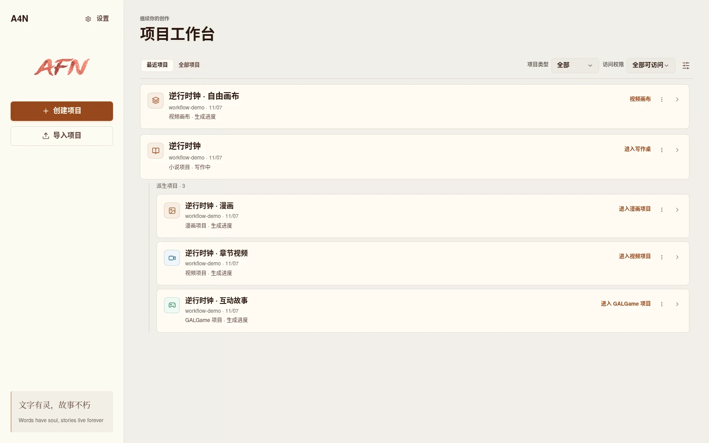](assets/workflow/00-projects.webp)

## 2. 灵感对话 / Develop an idea

从一句故事设想开始，通过选项与补充要求确定方向；此处已明确旧车站、未来来信、七分钟偏差和保留旧怀表的约束，可以生成首版蓝图。

Start with a story concept, choose a direction and add constraints. This conversation establishes the station, future letter, seven-minute anomaly and pocket-watch constraint before creating the first blueprint.

[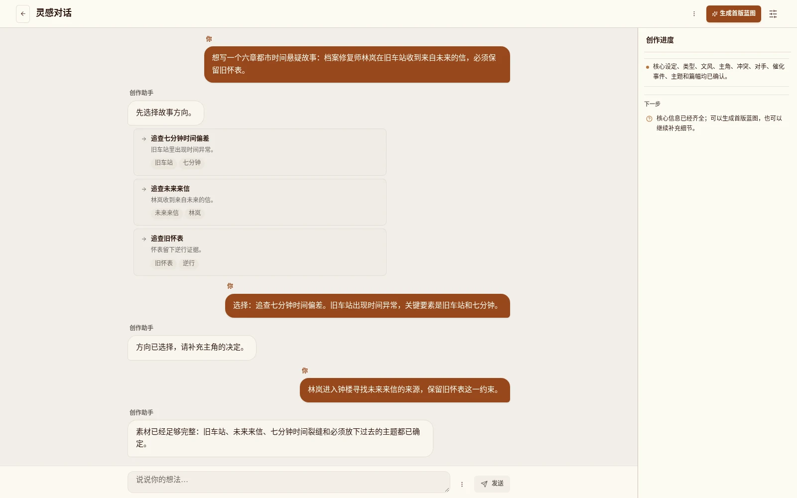](assets/workflow/01-inspiration.webp)

## 3. 故事蓝图 / Story blueprint

项目概览汇总目标读者、风格、情感基调和故事摘要，下面保留正文事实反馈入口。图中黄色提示来自章节资料变化后的真实状态：正式蓝图需要复核，尚未确认新版本。

The overview brings together audience, style, tone and the story summary, with fact-feedback controls below. The yellow banner is a real review state after chapter material changed: the formal blueprint needs review and a new version has not been confirmed.

[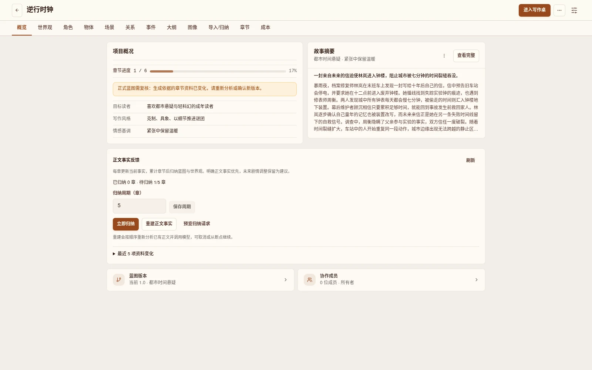](assets/workflow/02-blueprint.webp)

## 4. 正式章纲 / Formal chapter outlines

将故事拆为可进入写作台的章节。演示保存了《雨夜来信》《慢七分钟的钟》《地下机房回卷》三章章纲，后续正文只完成第一章。

Break the story into chapters that open in the writing desk. Three formal outlines are saved here; only the first chapter has completed text in this demonstration.

[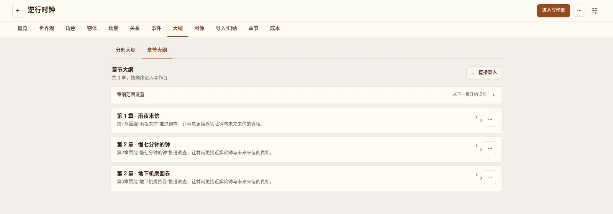](assets/workflow/03-outlines.webp)

## 5. 正文写作 / Write a chapter

写作台同时展示蓝图、人物资料、章节列表和当前章纲。第一章《雨夜来信》正文已保存，可继续编辑、切到分析，或使用写作助手。

The desk keeps the blueprint, character context, chapter list and current outline beside the saved first chapter. Continue editing, switch to analysis or open the writing assistant.

[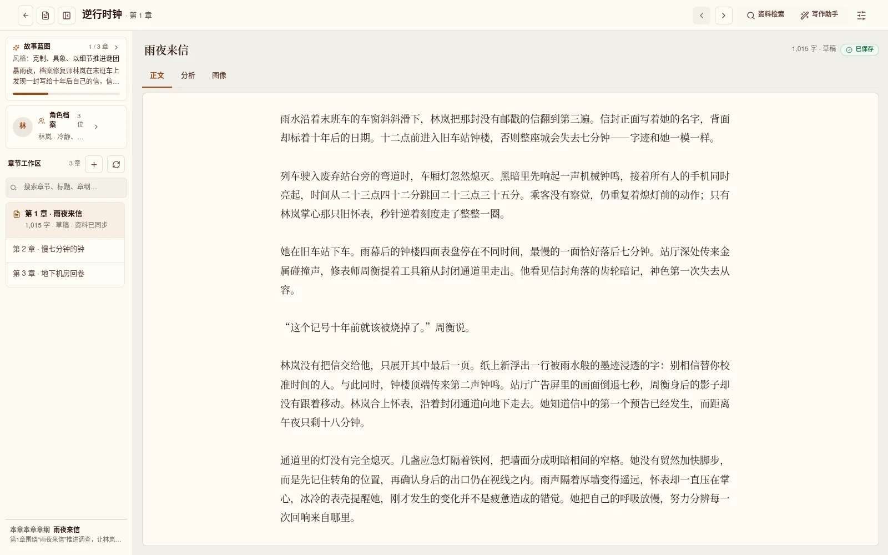](assets/workflow/04-writing.webp)

## 6. 分析与资料同步 / Analyze and synchronize knowledge

作者发起分析后，正文索引、章纲与伏笔、物品档案、角色资料和场景资料五类同步均已完成。结构化结果保留摘要、关键词、事件、人物状态与伏笔，便于核对和后续写作使用。

After author-initiated analysis, all five synchronization groups are complete. Structured results include a summary, keywords, events, character states and story threads for review and later writing.

[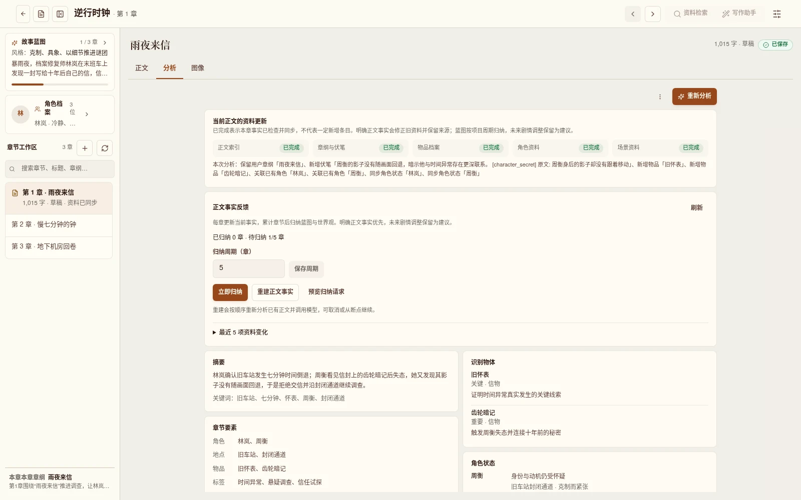](assets/workflow/05-analysis.webp)

## 7. 人物关系 / Character relationships

关系图把人物档案连起来。这里保存了林岚、周衡、顾沉三位人物和四条有方向的关系记录，双向关系分别显示。

The graph connects three character profiles through four directional relationship records. Reciprocal records appear separately.

[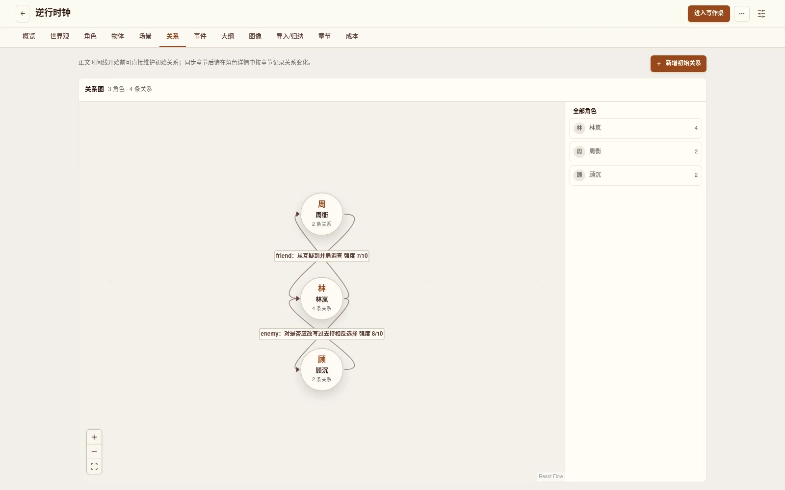](assets/workflow/06-characters.webp)

## 8. 漫画分镜规划 / Comic storyboard planning

第一条改编分支：来源章节经过预处理、改编计划采纳和分页后，保存了两页分镜及参考需求检查结果。当前选中第一页，可核对动作、对白、人物调度与用户补充图片入口。成图为 0/2，立绘尚未补齐；这里展示制作规划。

One adaptation branch prepares the source chapter, adopts an adaptation plan and saves two pages of storyboards and reference-needs checks. The selected page exposes action, dialogue, staging and user-added reference controls. Final images remain at 0/2 and portraits are still missing; this is production planning.

[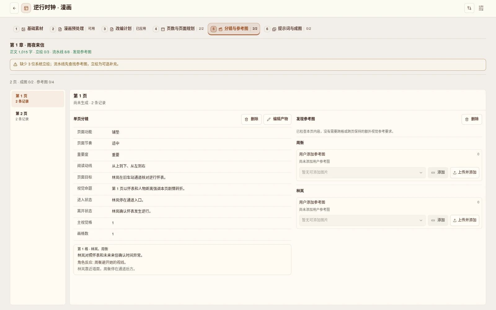](assets/workflow/07-manga.webp)

## 9. 视频导演编排 / Direct a chapter video

另一条改编分支：导演工作台用镜头、图片点和时间线表达方案。此处一个六秒镜头包含三个图片点，方案已确认，当前图片点绑定了预置车站示意图。

A separate adaptation branch uses shots, image points and a timeline. This confirmed plan contains one six-second shot with three image points; the selected point binds a prepared station illustration.

[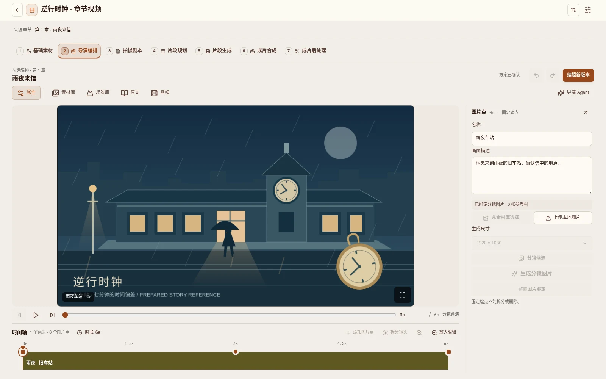](assets/workflow/08-director.webp)

## 10. 拍摄剧本 / Shooting script

确认导演方案后形成拍摄剧本，把场景目标、主要阻碍、景别、机位、调度和节拍展开为可核对的结构。截图展开了场景和镜头；后续片段生成与成片不在这组截图的完成范围内。

The confirmed director plan leads to a shooting script with scene goals, obstacles, framing, camera choices, staging and beats. The scene and shot are expanded here. Clip generation and finished video are beyond this screenshot session's completed scope.

[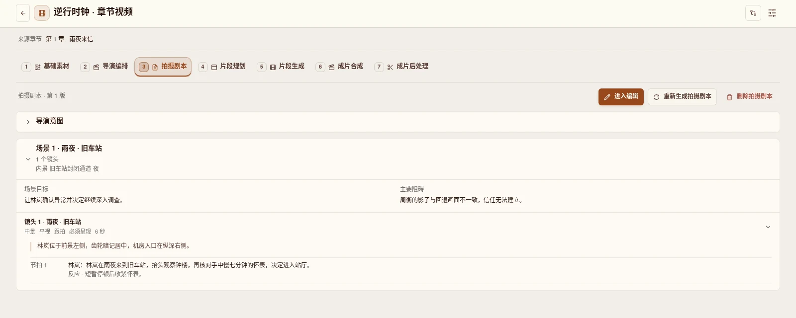](assets/workflow/09-screenplay.webp)

## 11. 互动故事 / Interactive story

第三条改编分支：同一章节保存为五个节点、五条连线和一个选择分支。左侧查看走向，右侧编辑选中节点的台词和选项；该故事也已在内置运行器中实际打开预览，本图展示编辑状态。

The third adaptation saves five nodes, five connections and one choice branch from the same chapter. Inspect the path on the left and edit dialogue and options on the right. The story was also opened in the built-in runtime; this image shows the editor.

[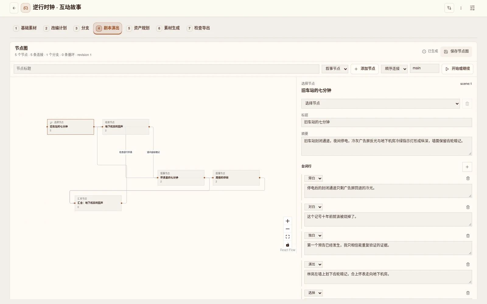](assets/workflow/10-interactive.webp)

## 12. 独立自由画布 / Independent freeform canvas

画布独立于上面的小说改编分支。手工导入六秒预置视频，裁剪第 1–5 秒后连接视频输出，同时抽取第 1 秒的画面并连接图片输出。右侧显示四个执行节点全部完成，源视频输入节点保持“就绪”。这里实际执行了媒体处理，未调用视频生成模型。

The canvas is independent of the novel adaptations. A manually imported six-second prepared clip is trimmed from seconds 1–5, saved through video output, and sampled at one second through frame extraction and image output. All four execution nodes completed; the input stays ready. Real media processing ran without a video-generation model call.

[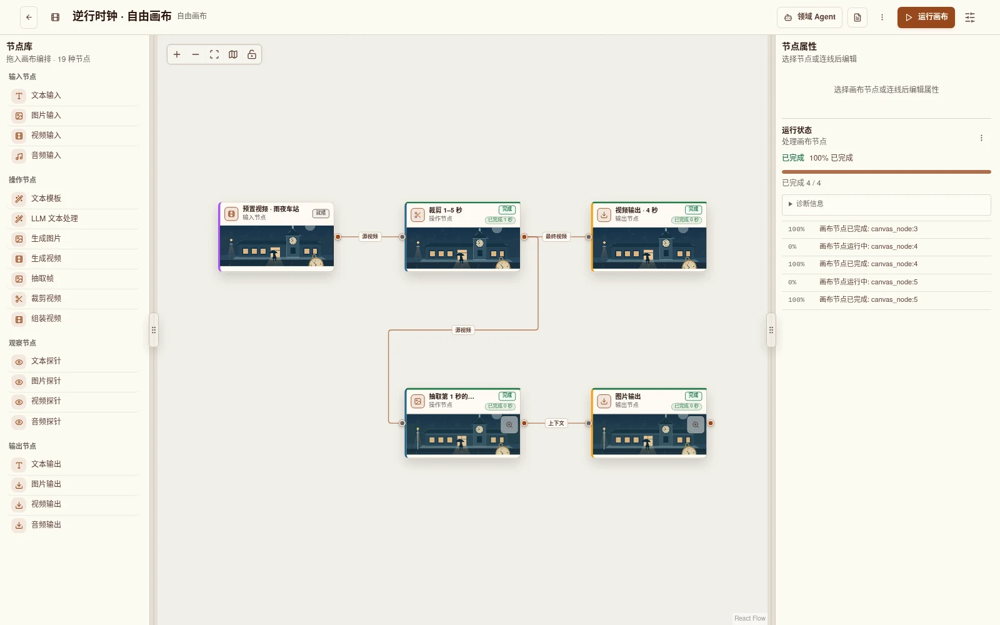](assets/workflow/12-canvas.webp)

## 13. 文件交付 / Export a file

回到小说项目，选择 TXT 并实际下载。导出对话框显示“下载完成”；已核对本地文件包含最新保存的完整章节，包括用于下一步来源比较的补充句。其他导出格式未在本轮逐一验证。

Back in the novel project, a TXT export is actually downloaded. The dialog shows completion, and the local file was checked against the full latest saved chapter, including the sentence added for the next source comparison. Other formats were not individually validated in this session.

[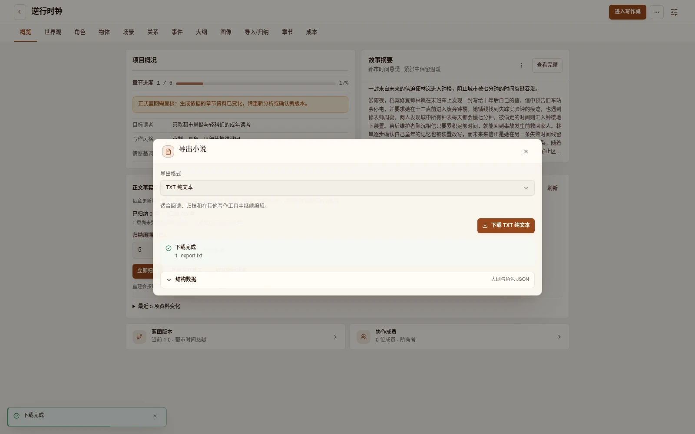](assets/workflow/13-export.webp)

## 14. 来源变化与同步预览 / Review source changes

在小说中补充一句“钟楼深处，第二声钟鸣比约定的时刻早了七分钟。”后，派生漫画显示一条来源变化。作者可以先看差异，再选择保留当前或应用安全更新；本轮只预览，没有应用同步，也没有重新生成下游媒体。

After adding a sentence about the clock tower's second chime arriving seven minutes early, the derived comic detects one source change. The author can inspect the difference and choose to keep the current version or apply safe updates. This session previewed the change without applying synchronization or regenerating media.

[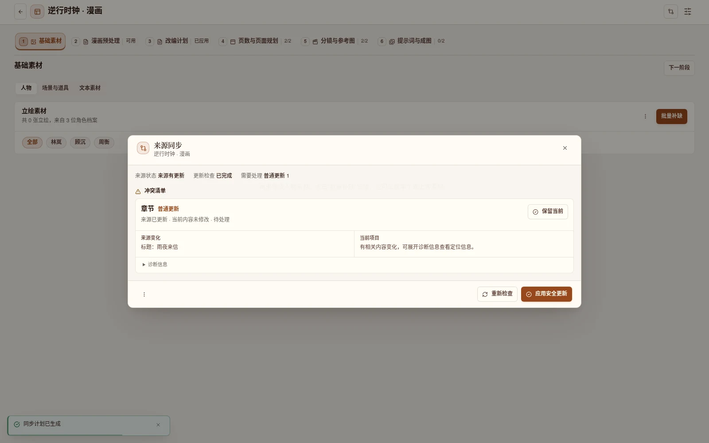](assets/workflow/14-source-sync.webp)

完整素材来源、拍摄基线和验证边界见[说明](demo.md#新增页面截图--workflow-screenshots)，逐图尺寸、摘要和实际检查结果见 [screenshots-validation.json](screenshots-validation.json)。

See the [media notes](demo.md#新增页面截图--workflow-screenshots) for provenance, baseline and limits, and [screenshots-validation.json](screenshots-validation.json) for image dimensions, hashes and measured checks.
